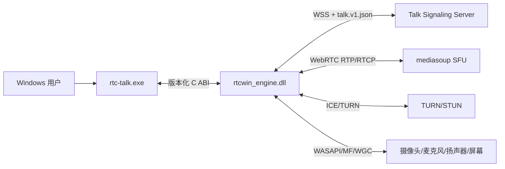

# 01 系统上下文与运行边界

## 1. 系统上下文



### 1.1 外部依赖

| 外部系统 | 协议 | 说明 |
|---|---|---|
| 信令服务 | WSS/JSON | 连接、房间、发言权、媒体控制、统计 |
| SFU | WebRTC | 多人的音频和视频转发 |
| TURN/STUN | ICE/UDP/TCP/TLS | P2P 连接和 relay |
| Windows 音频 | WASAPI | 录制、播放、loopback |
| Windows 视频 | Media Foundation | 摄像头枚举和采集 |
| Windows 桌面 | WGC/DXGI | 屏幕采集 |

## 2. 进程与二进制边界

### 2.1 `rtc-talk.exe`

职责：

- Qt 应用启动和主窗口。
- 应用服务、ViewModel、页面和视频 Surface。
- C ABI 客户端网关。
- 本地设置、日志展示、诊断导出。

禁止：

- 直接 include WebRTC、asio、Media Foundation、WGC 头文件。
- 直接持有 `PeerConnection`、`CameraCapture`、`talk_handle`。
- 直接解析信令 JSON。

### 2.2 `rtcwin_engine.dll`

职责：

- 管理 WebSocket/TLS、RPC、会话和房间状态机。
- 管理媒体设备、PeerConnection、SDP/ICE、视频轨道和统计。
- 将业务命令转换为媒体操作。
- 向 UI 进程回传类型化事件和帧。

禁止：

- 依赖 Qt Widgets。
- 访问 QSettings、QWidget、文件选择器。
- 保存 UI 选择状态或页面文案。

### 2.3 独立工具

| 工具 | 用途 | 发布 |
|---|---|---|
| `rtcwin-probe` | 摄像头/音频/屏幕设备诊断 | 独立诊断包 |
| `rtcwin-cli` | 连接/入房/媒体命令脚本化 | 独立诊断包 |
| `rtcwin-dump` | 日志和崩溃信息脱敏导出 | 主程序内置或独立 |

## 3. UI 与 Engine 的职责分界

| 能力 | UI 进程 | Engine DLL |
|---|---|---|
| WSS 连接 | 提交意图，展示状态 | 建立、保活、重连、关闭 |
| Room 状态 | 保存 UI 快照 | 服务端权威状态同步 |
| Token | 输入、内存保存 | 连接期间持有 |
| 设备枚举 | 发起和展示 | 调用 Windows API |
| 预览 | 显示 Surface | 管理采集和设备 |
| 发布 | 发起/停止命令 | 管理 sender/producer |
| 远端帧 | 接收 QImage 并渲染 | 解码、转换、投递 |
| 发言权 | 操作和展示 | 状态机和服务端同步 |
| 统计 | 展示 | 采集和聚合 |

## 4. 部署拓扑

```text
安装目录/
  rtc-talk.exe
  rtcwin_engine.dll
  log-runtime.dll
  Qt5Core.dll
  Qt5Gui.dll
  Qt5Widgets.dll
  Qt5Network.dll
  platforms/qwindows.dll
  styles/qwindowsvistastyle.dll
  imageformats/*.dll
  vc_redist.x64.dll / runtime files
  licenses/
```

用户数据目录：

```text
%LOCALAPPDATA%/rtc-talk-win/
  config/settings.json
  logs/talk-client.log
  diagnostics/
  crashes/
```

Token 不进入 `settings.json`。如果用户选择记住 Token，使用 Windows Credential
Manager，key 由应用 id + user id + server origin 组成。

## 5. 信任边界

```text
[不可信] 服务端 JSON / 远端 SDP / 远端帧 / 设备错误字符串
      │
      ▼
[校验层] ProtocolCodec / WebRTC adapter / Device adapter
      │
      ▼
[可信领域] typestate + 不变量 + bounded values
      │
      ▼
[UI 快照] 只读、不可直接修改
```

所有服务端输入在进入领域层之前必须经过：

- 消息长度上限。
- JSON 类型校验。
- 数值范围校验。
- UTF-8 合法性和字符串长度限制。
- 枚举白名单校验。
- 命令 ID 格式校验。

## 6. 失败边界

| 失败 | 处理 |
|---|---|
| 信令 WebSocket 断开 | 引擎进入重连状态，UI 显示连接中 |
| WSS 证书错误 | 不自动重试，提示证书/网络错误 |
| Token 过期 | 停止重连，回到凭证输入 |
| 摄像头权限拒绝 | 设备错误，保留音频/信令 |
| 摄像头被占用 | 显示占用错误，可重试或换设备 |
| WebRTC ICE 失败 | 进入媒体失败状态，尝试 TURN 或提示 |
| UI 进程关闭 | 引擎停止采集、发送 bye、释放设备 |
| 引擎崩溃 | UI 显示恢复提示，重启后不恢复敏感状态 |
