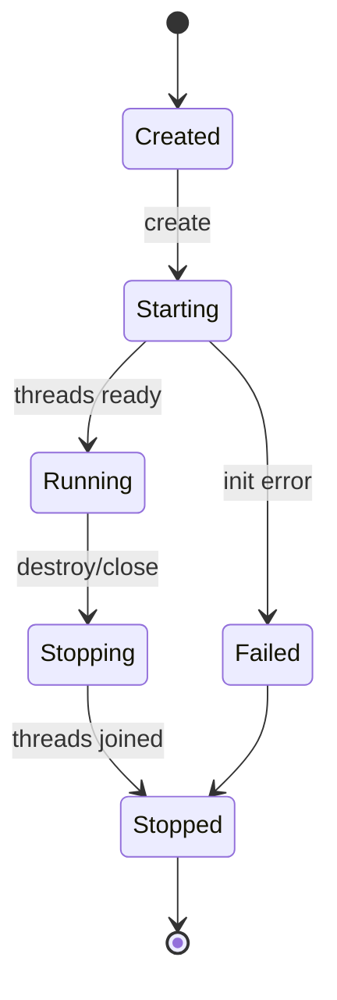
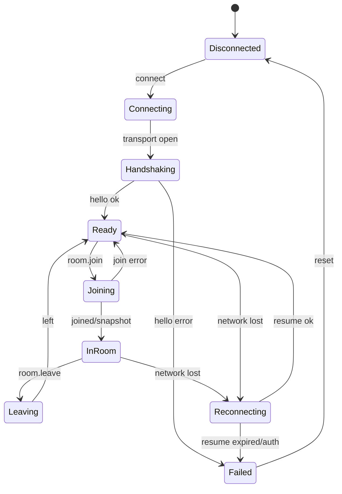
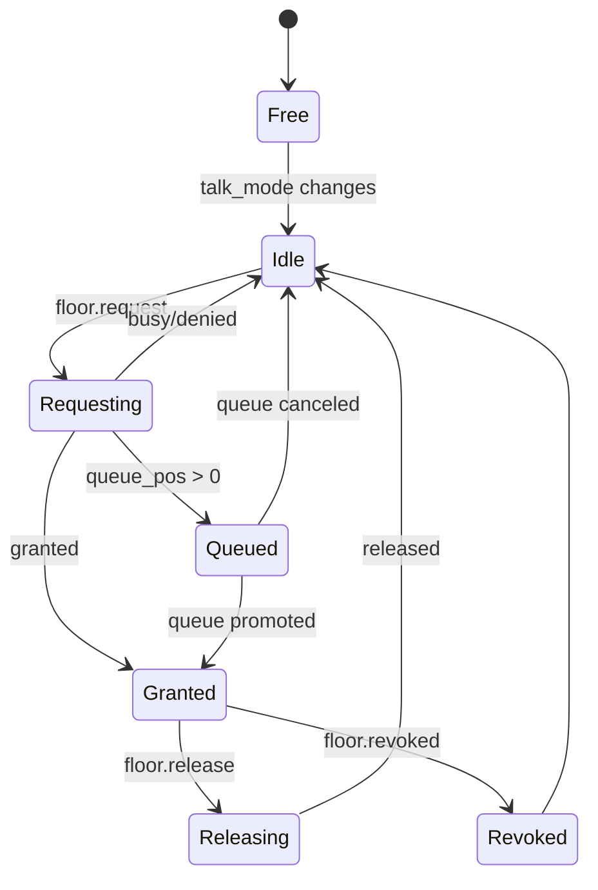

# 04 Engine、信令与会话状态机

## 1. Engine 组成

```text
rtcwin_engine.dll
  Engine
    EngineRuntime
    CommandRouter
    EventBus
    CorrelationRegistry
    GenerationGuard

  Signaling
    ITransport
    WsTransport
    RpcClient
    ReconnectPolicy
    ProtocolCodec

  Session
    SessionLifecycle
    RoomController
    FloorController
    HostController
    MediaModeCoordinator

  Media
    MediaCoordinator
    PreviewSession
    PublishPipeline
    RemoteVideoPipeline
    DeviceCoordinator
```

## 2. EngineRuntime

### 2.1 职责

- 持有控制线程和 asio `io_context`。
- 接收 UI 命令并排队。
- 管理命令 ID、deadline 和 correlation。
- 管理 generation。
- 驱动信令、状态机和媒体协调器。
- 将领域事件通过 C ABI 回调桥输出。

### 2.2 生命周期



### 2.3 Engine 主循环

```text
UI command
  -> ABI validation
  -> Command ID
  -> bounded command queue
  -> control thread
  -> CommandRouter
  -> Controller
  -> async operation
  -> CommandResult + DomainEvent
  -> EventBus
  -> C ABI callback
```

## 3. 信令传输

### 3.1 `ITransport`

```cpp
class ITransport {
 public:
  virtual ~ITransport() = default;
  virtual void Connect(const Endpoint&, const AuthToken&) = 0;
  virtual void Send(std::string message) = 0;
  virtual void Close(CloseReason) = 0;
  virtual void SetObserver(ITransportObserver*) = 0;
};
```

### 3.2 WebSocket/TLS

要求：

- `ws://` 只允许开发模式。
- `wss://` 验证证书链、主机名和过期时间。
- 支持建立超时、握手超时、心跳和关闭超时。
- 禁止在日志打印 Authorization、Token、完整 URL query。
- 所有收发消息受 `kMaxMessage` 限制。

### 3.3 传输状态

```text
Disconnected
  -> Resolving
  -> TcpConnecting
  -> TlsHandshaking
  -> WebSocketHandshaking
  -> Open
  -> Closing
  -> Closed
```

任意阶段失败进入 `Closed(error)`，由 `ReconnectPolicy` 决定是否重试。

## 4. RPC 层

```cpp
class RpcClient {
 public:
  CommandId BeginRequest(RpcMethod, Json data, Deadline);
  void Cancel(CommandId);
  void OnMessage(const Json&);
  void OnTransportClosed(TransportError);
};
```

要求：

- 请求 ID 本地唯一。
- 默认超时 10 秒；媒体 SDP 请求可单独配置。
- 超时后从 pending 表移除并回 `CommandTimedOut`。
- Server request 走独立 handler，不复用 client pending 表。
- 未知 response ID 进入诊断日志，不崩溃。

## 5. ReconnectPolicy

```cpp
struct ReconnectDecision {
  bool retry;
  std::chrono::milliseconds delay;
  bool resume;
  std::string reason;
};
```

规则：

- 网络断开：指数退避 + jitter。
- `session.kicked`：不重连。
- `replaced`：不重连。
- 401/403：停止重连，要求重新认证。
- 主动离房：不重连。
- 恢复窗口过期：清空房间并回到 prejoin。
- 重连期间保留只读快照，命令按资源类型拒绝或排队。

## 6. SessionLifecycle

当前实现状态（2026-10-29，B3-B5）：

- `libs/engine` 已有 `SessionStateMachine`，实现 `Disconnected`、
  `Connecting`、`SignalingReady`、`JoiningRoom`、`Joined`、`Leaving`、
  `Failed` 七个阶段，以及 `Unknown`、`Sfu`、`P2p` 三种媒体模式。
- 每次连接递增 session generation；join command 与 generation 绑定，
  信令、媒体、帧和定时器回调先校验 generation。
- `SessionController` 已承接 connect/join/leave/heartbeat 和信令回调；
  `EngineCore` 只保留线程、命令队列、模块装配和入口。
- `MediaOrchestrator` 已承接摄像头、媒体命令、SFU/P2P 协商和媒体事件；
  `MediaSession` 内部已拆出 `AudioPipeline`、`VideoPipeline`、
  `SdpNegotiator`、`MediaPeer`、`RemoteTrackRegistry`、`StatsCollector`。
- 当前实现尚未包含完整的 `Reconnecting -> resume` 分支；图示中的重连状态
  仍是后续 S7 的目标设计，不能视为已交付能力。



## 7. RoomController

职责：

- `room.join` / `room.leave`。
- 维护 room snapshot。
- 应用 peer join/update/left。
- 应用 policy patch。
- 控制 host 操作可用性。
- 把媒体模式变更交给 `MediaModeCoordinator`。

不负责：

- WebSocket 连接。
- 设备采集。
- QWidget。

接口：

```cpp
class RoomController {
 public:
  void Join(const JoinRoomCommand&);
  void Leave();
  void OnServerEvent(const ServerEvent&);
  void OnMediaModeChanged(MediaModeActual);
  RoomState Snapshot() const;
};
```

## 8. FloorController

状态：



规则：

- PTT/moderated 未持有发言权时，本地麦克风必须关闭。
- 服务端 `floor.state` 是权威。
- 释放超时后保持本地静音并显示错误。
- `revoked` 立即关闭本地采集门。

## 9. HostController

```text
Grant(uid, allow)
MuteAll(except_self)
Kick(uid)
UpdatePolicy(patch)
```

要求：

- 每次操作检查 self role 和当前 joined。
- policy 使用字段级 patch，不允许发送带默认值的全量对象覆盖未修改字段。
- 每个操作有结果和错误。
- 主持人 UI 只能反映服务端确认后的权威状态。

## 10. MediaModeCoordinator

```text
Idle
  -> SfuPublishing
  -> SfuSubscribed
  -> P2pNegotiating
  -> P2pConnected
  -> SwitchingToSfu
```

职责：

- 监听 `room.mediaMode`。
- 协调 SFU send/recv 和 P2P PeerConnection。
- P2P 连通后暂停 SFU 收发但不销毁连接。
- 切回 SFU 时恢复 sender 和订阅。
- 模式切换期间对 UI 发出 `MediaModeChanged`。

## 11. CommandRouter

```cpp
class CommandRouter {
 public:
  void Dispatch(const Command&);
 private:
  SessionLifecycle* session_;
  RoomController* room_;
  FloorController* floor_;
  HostController* host_;
  DeviceCoordinator* devices_;
  MediaCoordinator* media_;
};
```

Router 只做：

- 状态前提检查。
- 分派到控制器。
- 包装结果。

禁止 Router 直接访问 PeerConnection、WASAPI 或 QWidget。

## 12. CommandCorrelation

```cpp
struct PendingCommand {
  CommandId id;
  std::string method;
  Deadline deadline;
  uint64_t generation;
};
```

- 命令提交返回 ID。
- 引擎回 `CommandSucceeded` / `CommandFailed` / `CommandTimedOut`。
- 每个结果带原 command ID、method、generation。
- 超时定时器归 EngineRuntime 所有。

## 13. EventBus

事件分三类：

1. 领域状态事件：驱动房间/媒体状态。
2. 命令结果：驱动按钮状态和错误。
3. 诊断事件：日志、统计、错误码。

事件必须：

- 按控制线程顺序发出。
- 带 sequence number。
- 带 generation。
- 对 UI 是只读值。

## 14. 关闭

```text
Engine::Stop
  -> CommandRouter reject new commands
  -> ReconnectPolicy cancel timers
  -> RoomController detach
  -> MediaCoordinator stop preview/publish
  -> RemoteVideoPipeline remove sinks
  -> Signaling close
  -> asio stop
  -> join control/io threads
  -> EventBus stopped
```

任何步骤不允许在媒体回调线程中执行。
