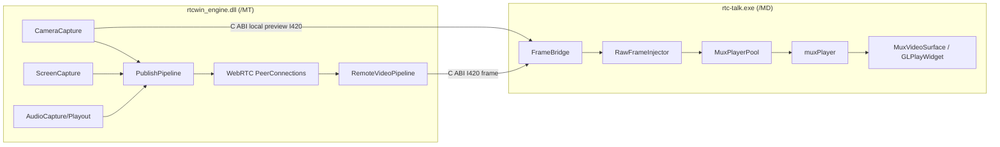

# 05 媒体、设备与 muxPlayer 播放架构

## 1. 范围

本文定义：

- WebRTC 音频和视频的采集、发布、订阅。
- 摄像头、WASAPI、WGC/DXGI 适配器。
- RTC 本地预览、远端视频、屏幕共享的视频渲染。
- muxPlayer 在 UI 进程中的强制集成方式。
- muxPlayer 解码注入扩展和渲染池。
- 音画同步、GPU 选择、降级、线程和关闭顺序。

## 2. 媒体总体拓扑



关键决策：

1. **RTC 音频仍由 WebRTC AudioDeviceModule 处理**，保留 AEC/AGC/NS、抖动缓冲和设备主控。
2. **RTC 视频不在 UI 直接画 QImage**，统一用 muxPlayer 渲染。
3. WebRTC 已经解码的 I420 帧直接注入 muxPlayer，不重新编码为 H.264/H.265。
4. muxPlayer 作为受控第三方依赖放在 UI 进程，不进入 `/MT` engine。
5. 本地摄像头预览和远端视频共用同一 `MuxFrameInjector` 渲染路径。

## 3. 为什么不能直接使用当前 `injectExternalStream`

当前 muxPlayer 的 `injectExternalStream` 接收 **H.264/H.265 编码包**，然后内部解码。
WebRTC 输出已经是解码后的 I420 帧。如果为了复用该接口先编码再解码，会带来：

- 不必要的 CPU/GPU 编码开销。
- 额外 50–200ms 延迟。
- 二次压缩损失。
- 与 RTC 发送编码器资源竞争。

因此必须在 muxPlayer 增加**解码后视频帧注入接口**。

## 4. muxPlayer 版本与集成策略

### 4.1 来源

只读参考：

```text
D:\work\device_tool\muxPlayer
device_tool commit: 4c3da7bf8ec92c0826e143918403cba5d61ab1db
```

新工程采用：

```text
third_party/muxplayer/source/     固定源码快照
third_party/muxplayer/patches/    rtc-talk-win 专用补丁
third_party/muxplayer/VERSION.md  来源 commit、文件清单、SHA256
third_party/muxplayer/PATCHES.md  每个补丁的目的和验收
```

不直接链接 `D:\work\device_tool` 当前工作树，避免参考工程状态变化污染构建。

### 4.2 补丁范围

必须新增/调整：

1. `RawVideoSource` 公共接口。
2. `MultiplexPlayer::openRawVideo()` / `pushRawVideoFrame()`。
3. `DecodedFrame` 支持 I420/NV12 CPU buffer 和 D3D11 texture。
4. `MuxRenderEnvironment` 支持共享 D3D11 device/context。
5. 渲染线程、Live 模式、latest-frame drop 行为。
6. 线程安全 close、重复 close、回调失效。
7. 对外提供更小的 `rtc_mux_player.h`，隐藏 FFmpeg、D3D 和 eventpp 细节。

不修改 muxPlayer 的协议解封装和本地文件播放能力。

### 4.3 构建

```text
muxPlayer.dll       /MD
FFmpeg DLL          vcpkg 固定版本
mtAudio/mtAudioPlayer 仅用于 muxPlayer 自身媒体播放
Qt OpenGL
```

`muxPlayer.dll` 只由 UI 进程加载。`rtcwin_engine.dll` 不链接 muxPlayer、Qt 或 FFmpeg。

## 5. muxPlayer 扩展 API

### 5.1 原始帧类型

```cpp
enum class RawVideoMemoryType {
  CpuI420,
  CpuNv12,
  D3D11Texture,
};

struct RawVideoPlane {
  const uint8_t* data = nullptr;
  int stride = 0;
};

struct RawVideoFrame {
  uint64_t frame_id = 0;
  int64_t pts_ms = 0;
  int width = 0;
  int height = 0;
  RawVideoMemoryType memory_type = RawVideoMemoryType::CpuI420;
  RawVideoPlane planes[3];
  void* native_texture = nullptr;  // ID3D11Texture2D*
  uint32_t subresource = 0;
  int color_space = 0;
  int full_range = 0;
};
```

所有权：

- CPU 帧由 `RawFrameLease` 持有，muxPlayer 只借用，不负责释放。
- D3D texture 由 engine 的 frame lease 持有；渲染完成前不得复用。
- 首版 RTC 使用 CPU I420，后续可增加 D3D11 共享纹理直通。

### 5.2 注入会话

```cpp
struct RawVideoOpenOptions {
  HWND hwnd = nullptr;
  int prefer_gpu = -1;
  bool low_latency = true;
  bool keep_last_frame = true;
  int max_render_fps = 30;
};

class MultiplexPlayer {
 public:
  bool openRawVideo(const RawVideoOpenOptions& options,
                    PlayerStatusCallback callback,
                    void* user_data);
  bool pushRawVideoFrame(const RawVideoFrame& frame);
  void setRawVideoSinkPolicy(RawVideoSinkPolicy policy);
};
```

`pushRawVideoFrame`：

- 非阻塞。
- 只保留最新帧；队列深度 1。
- 返回 `false` 表示会话关闭或超载。
- 不复制大帧，调用者通过 lease 保证生命周期。

### 5.3 Live 渲染

RTC 视频采用 `ClockMaster::None`：

- 帧到即渲染。
- 无 AV 同步等待。
- 通过 `max_render_fps` 和 Surface 可见性限流。
- 连续超载时丢旧帧，不积压。

本地文件/RTSP/FLV 继续使用 muxPlayer 音频、PTS、AV 同步能力。

## 6. 播放器模块

### 6.1 `MuxPlayerEnvironment`

职责：

- 初始化 Qt OpenGL/Format。
- 枚举 GPU。
- 选择硬解/软解、GL interop/D3D。
- 持有共享 D3D11 device/context。
- 检测 WGL_NV_DX_interop 和 OpenGL 3.3。
- 提供 GPU fallback。

```cpp
class MuxPlayerEnvironment {
 public:
  bool Initialize(const MuxEnvironmentOptions&);
  MuxCapabilities Capabilities() const;
  std::shared_ptr<MuxRenderDevice> RenderDevice();
};
```

### 6.2 `MuxPlayerSession`

一个活动视频流对应一个 session：

```cpp
class MuxPlayerSession {
 public:
  MuxPlayerSession(std::shared_ptr<MuxRenderDevice>);
  bool Open(const MuxSessionOptions&);
  void PushFrame(RawFrameLease frame);
  void Clear();
  void Close();
  QWidget* Surface();
};
```

内部拥有：

- `muxplay::MultiplexPlayer`
- `GLPlayWidget` 或 D3DRenderWidget
- latest-frame queue
- 状态映射
- 帧率/丢帧统计

### 6.3 `MuxPlayerPool`

职责：

- `mid -> MuxPlayerSession` 映射。
- Surface 生命周期与 VideoTile 分离。
- 最多 9 个活动 session。
- 复用 2 个空闲 session，减少切换房间时初始化延迟。
- 隐藏/缩略图降低渲染帧率。
- 共享 `MuxRenderDevice`。

```cpp
class MuxPlayerPool {
 public:
  MuxPlayerSession* Acquire(const TrackId&);
  void Release(const TrackId&);
  void SetVisible(const TrackId&, bool);
  void SetCompact(const TrackId&, bool);
  void Shutdown();
};
```

### 6.4 `RawFrameInjector`

将 C ABI 的 `rtcwin_frame_view` 转为 muxPlayer 的 `RawVideoFrame`：

- 校验 stride、宽高、像素格式。
- 复制到 `FrameLease` 或使用回调内的 ref-count 帧。
- 通过 UI queued dispatch 推送。
- `mid` 路由到 `MuxPlayerPool`。
- producer paused 或流移除时 `Close/Clear`。

```cpp
class RawFrameInjector {
 public:
  void OnRemoteFrame(const rtcwin_frame_view&);
  void OnLocalPreviewFrame(const rtcwin_frame_view&);
  void ClearStream(const TrackId&);
};
```

## 7. 本地预览

```text
MF Camera Capture
  -> I420 Copy
  -> C ABI local frame
  -> RawFrameInjector
  -> MuxPlayerPool("local:camera")
  -> MuxVideoSurface
```

要求：

- 预览使用 Live 渲染。
- 支持前后台切换、设备切换和镜像。
- 预览和摄像头发布共享 capture session，但渲染 Player 独立。
- 停止预览只移除 `Preview` consumer，不停止发布。

## 8. 远端 RTC 视频

```text
WebRTC VideoTrack sink
  -> WebRTC I420 frame
  -> frame lease/copy
  -> remote video pipeline
  -> C ABI frame callback
  -> MuxPlayerPool(mid)
  -> muxPlayer Live render
```

规则：

- `mid` 是唯一键。
- camera 和 screen 使用不同 Tile 和 MuxPlayerSession。
- 帧队列深度 1。
- producer paused 立即 `Clear()`。
- 5 秒无帧释放/隐藏 Surface。
- 流恢复时重新使用 session 或从池中获取。

## 9. 屏幕共享

共享画面使用与远端 RTC 视频相同的 muxPlayer 渲染路径。

本地屏幕共享预览：

- 采集源产生 I420/NV12；
- C ABI local screen frame；
- `MuxPlayerPool("local:screen")`；
- 共享主画面同样由 muxPlayer 渲染。

首版选择主屏，多屏扩展时 SourceId 不改变上层接口。

## 10. 宫格、聚焦和 PIP

### 10.1 多路视频

- 每个可见流一个 `MuxPlayerSession` + `MuxVideoSurface`。
- `VideoLayoutEngine` 只负责 Geometry/可见性。
- Surface 不直接参与业务状态。
- 隐藏 tile 停止或降到 1fps 更新；恢复时请求最新帧。

### 10.2 1v1 PIP

- 远端主画面：muxPlayer main session。
- 本机 PIP：独立 `MuxPlayerSession("local:camera")` 和 Surface。
- PIP 位置由 Qt 布局计算，不使用 muxPlayer 内部 PIP。

原因：

- RTC 房间的业务 overlay 和成员选择属于 Qt；
- muxPlayer PIP 仅支持单个 D3D SwapChain 画面，不适合多 Surface 布局；
- Qt 布局更容易支持 DPI、拖拽和不同显示模式。

### 10.3 共享布局

- 共享流主画面：muxPlayer screen session。
- 底部胶片条：每个成员 camera session。
- 同一流可以在主画面与缩略图中共享同一个 muxPlayer session，但只渲染一个 Surface。

## 11. 音频设计

### 11.1 RTC 音频

```text
WASAPI capture/playout
  -> WebRTC AudioDeviceModule
  -> Opus / RTP
```

保留 WebRTC ADM 的原因：

- AEC/AGC/NS。
- NetEq 抖动缓冲。
- 采样率转换。
- RTP 音画同步。
- 设备热切换。

muxPlayer/mtAudio 不参与 RTC 麦克风采集和远端播放。

### 11.2 muxPlayer 音频

用于：

- 本地媒体文件。
- RTSP/FLV 诊断播放。
- 未来录像回放。

`mtAudioPlayer` 生命周期由 `MuxPlayerSession` 的 auxiliary media 模式管理。

## 12. GPU 和降级

### 12.1 模式优先级

```text
Hardware D3D11VA + WGL_NV_DX_interop
  -> Hardware D3D11VA + SwapChain
  -> Software + GL YUV Shader
  -> Software + D3D11 upload
```

### 12.2 GPU 选择

- 枚举 GPU：tmcore 或 DXGI。
- 用户可指定 GPU。
- 所有 session 使用同一 GPU 和 D3D device。
- 显卡切换需要重建整个 `MuxPlayerEnvironment`。
- 默认优先独显。

### 12.3 失败处理

- GL interop 不可用：切 D3D SwapChain。
- 硬件解码不可用：切软件解码。
- 设备/驱动异常：显示媒体错误，不崩溃。
- 回退过程不能重建整个房间 UI。

## 13. 性能策略

| 场景 | 策略 |
|---|---|
| 主画面 | 最高 30fps |
| 缩略图 | 最高 15fps |
| 隐藏 tile | 停止渲染，只保留最新帧 |
| 多个远端流 | 最多 9 个活动 session |
| 队列 | 每流 1 帧 |
| 帧拷贝 | 目标 1 次 I420 copy；后续评估 D3D shared texture |
| GPU 设备 | 共享 D3D device |
| 关闭 | 移除 sink 后释放 Surface/Player |

性能门槛：

- 9 路 720p 视频时 UI 主线程无明显卡顿。
- 单路 1080p Live 延迟目标 < 150ms（不含网络）。
- 连续开关 100 次无死锁和无资源增长。

## 14. 线程模型

| 对象 | 线程 | 说明 |
|---|---|---|
| WebRTC receiver | media worker | 产生 I420 |
| engine frame bridge | media thread | 拷贝/lease，C ABI 回调 |
| UI RawFrameInjector dispatch | Qt UI thread | 路由到 MuxPlayerSession |
| muxPlayer frame queue | UI/worker | 有界 latest-frame |
| muxPlayer renderer | render thread | D3D/GL 资源 |
| GLPlayWidget::paintGL | Qt GL thread | 最终绘制 |
| MuxPlayerSession::Close | Qt UI thread | 停止并 join |

约束：

- 不在 WebRTC 媒体线程操作 QWidget。
- 不在 GL 线程调用业务状态机。
- D3D ImmediateContext 由共享 mutex 保护。
- `close()` 在任何线程被调用时都必须最终回到 owner 线程同步。

## 15. 关闭顺序

```text
RoomPage 离开
  -> VideoGrid detach surfaces
  -> MuxPlayerPool.Release(mid)
  -> session.Close:
       remove frame sink
       stop input queue
       stop renderer
       GL context makeCurrent
       destroy display/resources
       doneCurrent
  -> video tile hidden
  -> engine remote sink removed
```

关闭要求：

- 每个 session 幂等。
- 不依赖 Qt 销毁顺序。
- 不把 `deleteLater()` 当作资源释放保证。
- 关闭完成后才能销毁 `MuxRenderEnvironment`。

## 16. 测试

### 16.1 muxPlayer adapter 单元测试

- Raw frame stride/pixel format validation。
- latest-frame queue 丢旧保新。
- session open/close 幂等。
- surface 可见性降帧。
- producer pause 清屏。
- frame timeout 清屏。

### 16.2 组件测试

- Fake I420 source -> muxPlayer session -> Surface 状态。
- 2/4/6/9 路 tile 生命周期。
- 摄像头预览启停 100 次。
- GPU 模式 fallback。

### 16.3 真实链路

- 本地摄像头预览。
- P2P 摄像头远端。
- SFU 多人多路视频。
- 屏幕共享主画面。
- 共享停止后立即清屏。
- 9 路 720p 稳定性。

## 17. 风险

| 风险 | 对策 |
|---|---|
| muxPlayer 当前只支持编码流注入 | 增加 RawVideoSource 补丁 |
| 多实例 D3D device 过多 | 引入共享 MuxRenderEnvironment |
| `/MD` Qt 与 `/MT` WebRTC CRT | muxPlayer 仅在 UI 进程，engine 走 C ABI |
| WGL interop 驱动兼容 | D3D SwapChain 与软件 GL 降级 |
| 视频 tile 多、GL context 多 | session 池、隐藏降帧、共享 device |
| FFmpeg/OpenSSL 依赖膨胀 | 只发布必需 DLL，锁定版本和安全更新 |
| muxPlayer 源码与上游分叉 | 固定来源 commit、补丁清单、回归测试 |
| RTC 和本地播放音频冲突 | RTC 只用 WebRTC ADM，muxPlayer 音频限辅助媒体 |

## 18. 明确结论

- muxPlayer 是 **RTC 视频渲染的唯一实现**，不是可选参考。
- 需要为其增加解码帧注入 API，避免 RTC 视频二次编码。
- muxPlayer 保留在 UI 进程 `/MD`，engine 保持 `/MT`。
- 所有业务页面通过 `MuxVideoSurface`/`MuxPlayerPool` 使用播放器，不直接调用 muxPlayer。
- 本地预览、远端视频、共享画面、1v1 PIP 全部走同一渲染基础设施。
