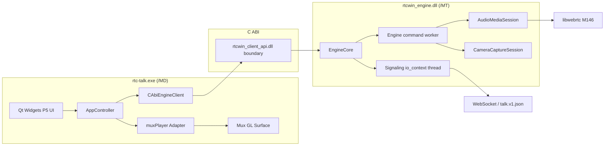
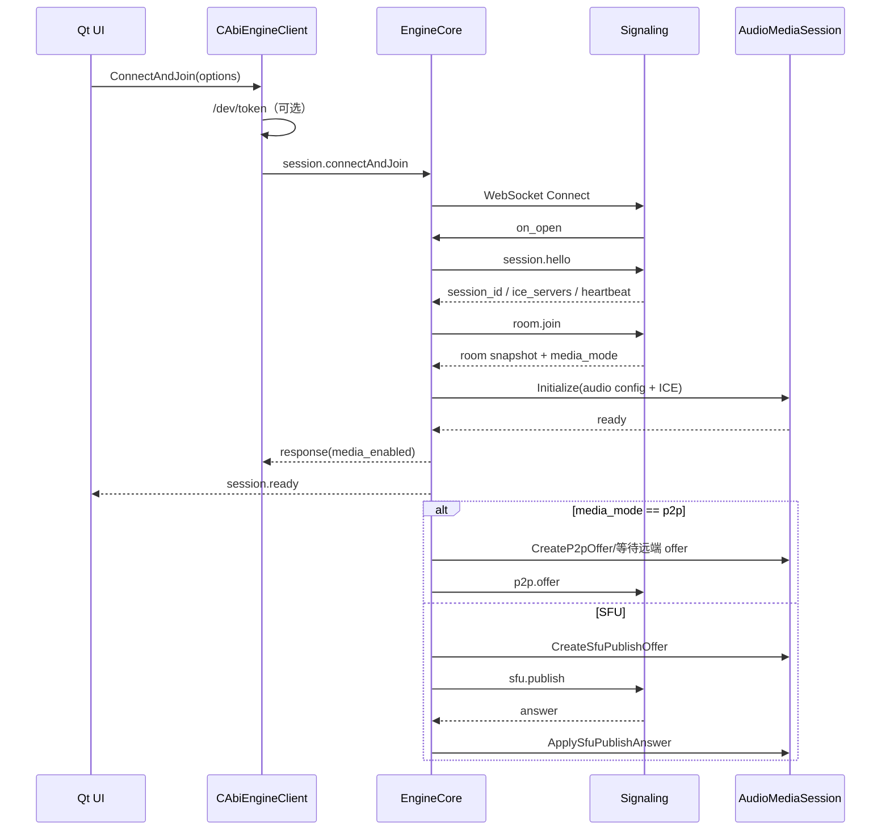
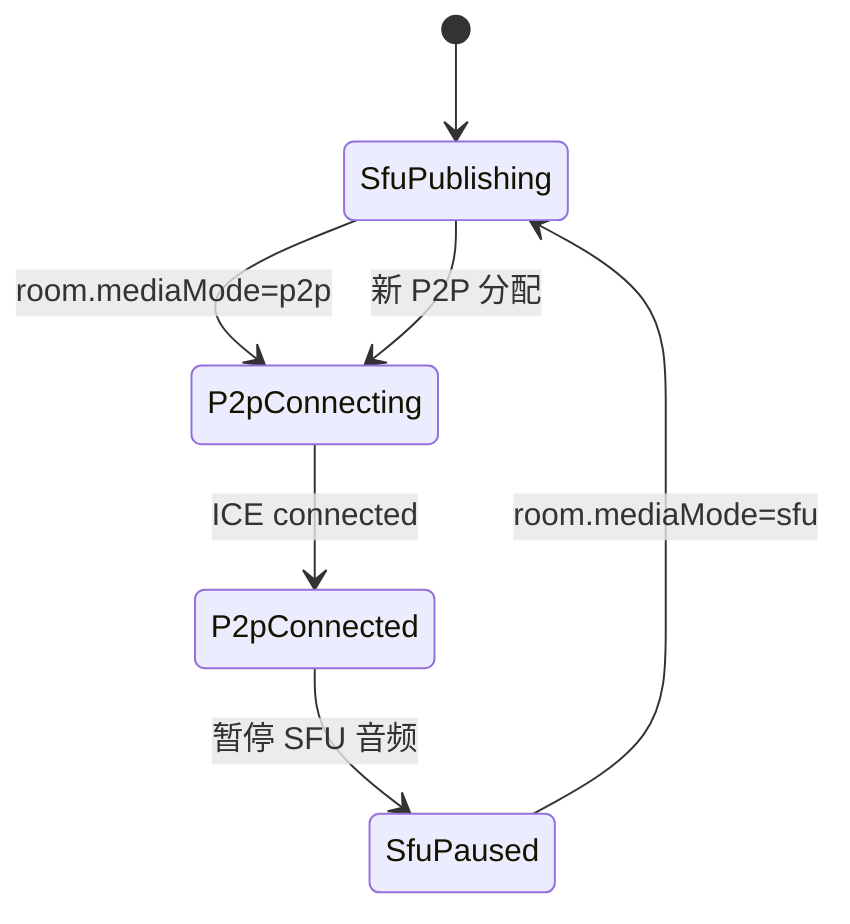

# rtc-talk-win 项目交接文档

> 快照日期：2026-10-29  
> 仓库：`D:\google\webrtc-win-client\rtc-talk-win`  
> 分支：`rtc-talk-win`  
> 已推送音频基线：`5ab73fa feat: 接入WASAPI系统音采集`
>
> 当前状态：S3.2 核心音频链路已通过 1v1 P2P、第三人切 SFU 和静音停发短链路验证；收听、音量、设备异常和完整恢复仍需继续验收。
> 旧工程：`D:\google\webrtc-win-client\rtc-talk`，只读参考，禁止修改或提交。

本文档面向后续接入业务、继续媒体开发、做代码评审或发布验收的工程师。它描述当前真实代码状态，不把计划中的能力写成已完成能力。
## 0. 来源基线、参考分支和计划追溯

本节是交接的权威入口。后续实现、协议判断和验收必须以此处固定的仓库、分支、提交和文档为准。旧仓库工作树可能包含未提交变化，不能把“当前检出文件”当作权威版本。

### 0.1 仓库与固定参考基线

| 类别 | 仓库 / 分支 / 提交 | 本工程中的用途 | 权限 |
|---|---|---|---|
| 当前生产工程 | `D:\google\webrtc-win-client\rtc-talk-win` / `rtc-talk-win` / `5ab73fa` | 真正交付工程、当前开发分支 | 可开发、可提交到 `rtc-talk-win` |
| 服务端权威参考 | `D:\google\webrtc-win-client\rtc-talk` / `origin/main` / `8e6ff57` | 服务端行为、协议口径、S4 差异和联调依据 | 只读 |
| 旧 Windows 客户端功能参考 | `origin/feat/windows-client` / `df22708` | `client-win` demo、既有音视频功能和联调逻辑参考 | 只读 |
| 旧 Windows 生产实现参考 | `origin/codex/feat/windows-production-client` / `bbb3891` | P5 UI、生产模块、历史改造和验收记录参考 | 只读 |
| P5 UI 运行基线 | `D:\google\webrtc-win-client\rtc-talk\client-win\build\windows-x64\bin\Release\talk-desktop.exe` | 视觉和控件验收，不得自行改版 | 只读 |
| P5 UI 源码参考 | `D:\google\webrtc-win-client\rtc-talk\client-win\ui\desktop` | 控件结构、主题和房间页行为参考 | 只读 |
| muxPlayer 用户封装源码 | `rtc-talk-win/third_party/muxplayer` 及其依赖 | 产品内视频渲染基础设施 | 本仓库可维护 |
| libwebrtc SDK | `WEBRTC_SDK_DIR`，当前 M146 | 外部开发 SDK，不复制整库进仓库 | 外部依赖 |

强制规则：

1. 服务端协议以 `rtc-talk` 的 `origin/main@8e6ff57` 为准，不以本地 `main` 或旧仓库当前工作树为准。
2. 旧仓库当前工作树存在未提交变化，交接和排障必须注明固定远端提交，不得依赖其本地脏工作树。
3. 不修改、不提交 `main`、`feat/windows-client`、`codex/feat/windows-production-client` 或其他参考分支。
4. 本地 `client-win` demo 只能提供行为和实现参考，不能直接决定生产架构。
5. 所有旧客户端分支只作为只读对照；如发现逻辑问题，记录到本工程计划或问题单，不回写参考分支。

### 0.2 必须一起阅读的计划和协议文件

| 文件 | 权威内容 | 对本工程的作用 |
|---|---|---|
| `rtc-talk/plan/talk-protocol.md` | `session.hello/ping/refreshIce`、`room.join/leave`、`media.setMute`、`sfu.publish/offer/restartIce`、P2P、媒体模式切换、resume、PTT 和视频约束 | 信令与媒体协议的最高优先级参考 |
| `rtc-talk/plan/rtc-server-dev-plan.md` | 服务端房间、SFU consume/produce、P2P 分配、第三人切 SFU、失败回退和已知修复 | 判断服务端请求时序、错误码和联调行为 |
| `rtc-talk/plan/RK3576_客户端_开发计划_b524300f.md` | 跨平台客户端完整计划、P2P/SFU 踩坑、resume、事件时序和验收经验 | 客户端媒体状态机和回归风险参考 |
| `rtc-talk-win/plan/production-plan.md` | 当前 Windows 生产工程 S0-S8、P0-P5、门禁和维护规则 | 当前工程实施计划；文档内部基线可能早于当前提交，实施时以代码和本表状态为准 |
| `rtc-talk-win/docs/requirements.md` | 产品功能和非功能要求 | 功能验收 |
| `rtc-talk-win/docs/architecture/*` | 当前生产工程架构设计 | 模块边界和后续重构 |
| `rtc-talk-win/docs/build-and-test.md` | 构建、依赖和测试说明 | 开发环境复现 |

协议实现发生分歧时，优先级为：

```text
服务端 origin/main 的协议实现与 talk-protocol.md
  > rtc-server-dev-plan.md
  > Windows 客户端参考分支
  > 当前客户端既有实现
```

如果当前实现与服务端协议冲突，必须记录冲突并修正客户端，不能为了兼容旧 demo 继续扩大偏差。

### 0.3 计划追溯矩阵

状态定义：

- **已完成并推送**：代码、构建和阶段验收已完成，提交在远端。
- **代码完成待验收**：实现已落盘并通过本地构建/短链路测试，但业务链路尚未验收。
- **部分完成**：核心能力已有，但计划要求尚未全部满足。
- **未开始**：没有可交付实现。

| 计划项 | 计划要求 | 当前状态 | 代码 / 测试 | 剩余验收 |
|---|---|---|---|---|
| S0 | 工程、依赖、分支和基线 | 已完成并推送 | `d49836f` | 无 |
| S1 | muxPlayer、本地摄像头、C ABI、P5 UI | 已完成并推送 | `de3a7f1`、摄像头预览、muxPlayer 截图 | 长稳定性测试按用户要求另行安排 |
| S2 | 信令、认证、房间生命周期、成员快照 | 已完成并推送 | `98f1ee8`、`rtcwin_signaling_tests`、双客户端联调 | 无 |
| S3.1 | libwebrtc 音频设备枚举与预入会选择 | 已完成并推送 | `53a8fdd`、`rtcwin_audio_devices_probe` | 无 |
| S3.2 | 音频 PeerConnection、P2P/SFU、静音、音量、收听、系统音 | 核心完成并推送，待完整人工验收 | `5ab73fa`、`AudioMediaSession`、WASAPI loopback | 收听/音量听音、设备异常、离房重进和恢复 |
| S4 | 视频发布、远端视频、muxPlayer 渲染、屏幕共享 | 未开始 | 当前只有本地摄像头预览 | SFU video、P2P video、consume mid 映射、画面回收 |
| S5 | 成员、发言权、主持人、PTT/审核模式 | 部分完成 | 房间成员/策略/floor 快照已有；floor 请求仍为 501 | floor.request/release、revoked、keepalive、主持人操作 |
| S6 | 设备、统计、日志和诊断 | 部分完成 | 摄像头/音频设备枚举、`media.stats` 基础字段 | RTCStats、设备热插拔、设置弹窗、脱敏日志、诊断面板 |
| S7 | 重连、resume、ICE refresh、安全 | 未开始 | 当前关闭后重置媒体，无 resume | generation guard、WSS、resume、ICE restart、错误恢复 |
| S8 | 安装包、签名、升级和发布验收 | 未开始 | 无 | 安装包、依赖清单、签名、升级和发布验收 |
| P0 | 计划与依赖审计 | 已完成 | 本工程依赖边界和构建脚本 | 后续计划变更时维护 |
| P1 | muxPlayer 可构建 | 已完成并推送 | `de3a7f1` | 无 |
| P2 | muxPlayer 原始帧注入 | 已完成并推送 | `de3a7f1` | 远端帧接入在 S4 完成 |
| P3 | 本地摄像头采集与 C ABI | 已完成并推送 | `de3a7f1` | WebRTC 视频发布在 S4 完成 |
| P4 | UI 本地预览联调 | 已完成并推送 | P5 预入会页、真实摄像头截图 | 视觉改动必须继续对照 P5 |
| P5 | 第一里程碑稳定性与提交验收 | 已完成阶段验收 | Release/Debug 构建、既有联调 | 长稳定性测试按用户明确要求执行 |

### 0.4 当前计划偏差

必须明确记录以下偏差：

1. `plan/production-plan.md` 已同步到 `rtc-talk-win@5ab73fa`，后续提交仍需持续维护基线。
2. `talk-protocol.md` 定义了 resume、ICE restart、P2P/SFU 先建后断、视频 m-line 等完整约束，当前 S3.2 只实现音频主链路。
3. 第三人加入“先建 SFU、确认可用、再关 P2P”已在短链路验证，后续仍需覆盖网络异常和重复切换。
4. 服务端计划包含 `p2p.state`、P2P 失败回退、10 秒超时和 candidate 缓存等约束，当前客户端只完成基础转发，没有完整恢复策略。
5. 计划中的 S5-S8、视频、设备热插拔、WSS、resume 和安装包均不能在交接中写成已完成。

---


---

## 1. 先看这里：当前结论

### 1.1 当前已经具备

- Windows x64 Qt Widgets 桌面客户端工程。
- P5 预入会页、房间页和底部圆形控制栏基线。
- Windows Media Foundation 摄像头枚举、采集、NV12 -> I420。
- muxPlayer 完整源码和用户封装依赖已迁入本仓库。
- 本地摄像头经 muxPlayer 软件 OpenGL 路径出画。
- WebSocket 信令、开发 Token、`session.hello`、`room.join/leave`、心跳。
- 房间成员、角色、策略、发言权、媒体模式等快照与增量通知。
- libwebrtc M146 的 Windows Core Audio 设备枚举。
- 预入会页真实录音/播放设备列表。
- 独立 `AudioMediaSession`：
  - Windows Core Audio ADM。
  - Opus 编解码工厂。
  - APM/3A。
  - 本地音频轨。
  - SFU publish offer/answer。
  - SFU subscribe offer/answer。
  - P2P offer/answer/ICE candidate。
  - 静音、收听静音、音量、SFU 暂停。
  - P2P 连通后暂停 SFU 音频，避免双路重复播放。
- Engine 内已接入：
  - `sfu.publish`
  - 服务端 `sfu.offer`
  - 服务端 `room.mediaMode`
  - `p2p.offer/answer/candidate/close`
  - `media.setMute`
  - `media.setVolume`
  - `media.setDeafened`
  - `media.stats`
- UI Gateway 已能消费：
  - `media_enabled`
  - `media.ready`
  - `media.published`
  - `media.muted`
  - `media.deafened`
  - `media.error`

### 1.2 当前还没有验收

以下是“代码已写但还不能宣布完成”的部分：

- 服务端强制静音、收听静音和音量的端到端人工听音。
- 设备拔出、设备占用、默认设备切换。
- 断线重连/resume。
- 摄像头和屏幕共享接入 WebRTC 发布/订阅。
- 远端视频经 muxPlayer 播放。
- WSS/TLS 信令。
- 完整生产诊断、打包和安装。

### 1.3 当前工作树状态

S3.2 音频修复已经提交并推送为 `3b79703`。当前代码基线包含：

- 独立 `AudioMediaSession` 与真实 ADM 音频链路。
- P2P/SFU 双向音频、静音门和 RTP 诊断。
- P2P -> SFU 先建后断切换。
- trace 脱敏、`none` 后端和远端音轨生命周期修复。
- Release/Debug 构建与 CTest 3/3 通过。

---

## 2. 项目宗旨和不可破坏的约束

### 2.1 项目宗旨

`rtc-talk-win` 是正式生产工程，不是 `client-win` demo 的换皮版本。

它的目标是：

```text
Qt Widgets UI
  -> 应用控制器
  -> 版本化 C ABI
  -> 媒体引擎 DLL
  -> libwebrtc / 摄像头 / 音频设备
  -> muxPlayer 视频渲染
```

生产原则：

- UI 不在 UI 线程直接操作 libwebrtc。
- UI 不直接链接 libwebrtc。
- libwebrtc 只在 Engine 内部使用。
- 用户自有封装库必须完整存入本仓库。
- Qt、Visual Studio、CMake、vcpkg 属于开发环境，可通过环境变量引用。
- 产品运行时不得依赖其他工程的绝对路径。
- 旧 `rtc-talk` 只读。
- 不改 `main` 或其他分支。
- 未经明确要求，不运行长时间稳定性测试。
- P5 是 UI 基线，不允许重新“创意设计”。

### 2.2 UI 基线

参考程序和源码：

```text
D:\google\webrtc-win-client\rtc-talk\client-win\build\windows-x64\bin\Release\talk-desktop.exe
D:\google\webrtc-win-client\rtc-talk\client-win\ui\desktop
```

已有截图：

```text
D:\google\webrtc-win-client\rtc-talk-win\build\screenshots\s2-room-controls-p5.png
D:\google\webrtc-win-client\rtc-talk-win\build\screenshots\s3-audio-devices.png
```

房间控制栏基线：

- 左侧：闭麦、摄像头、共享屏幕。
- 右侧：收听、设置、离开。
- 使用圆形 `IconButton`，不要恢复成错误的大圆角矩形按钮。
- 顶部人数和 `3/9` 等文案必须完整显示。

---

## 3. 当前系统架构

### 3.1 进程与模块拓扑



### 3.2 分层

| 层 | 目录 | 职责 |
|---|---|---|
| Domain | `libs/domain` | 纯领域类型、快照、错误、恢复动作 |
| Application | `libs/application` | Qt `QObject` 控制器、设置持久化、UI 与引擎边界 |
| Client API | `libs/client_api` | 稳定 C ABI |
| Engine | `libs/engine` | 命令队列、信令编排、房间/媒体状态、C ABI 实现 |
| Client Gateway | `libs/client_gateway` | `QNetworkAccessManager` 开发 Token、C ABI -> Qt signal |
| UI | `libs/ui` | P5 Qt Widgets 页面、主题、控件、muxPlayer surface |
| Camera | `libs/camera_win` | Media Foundation 枚举和采集 |
| Signaling | `libs/signaling` | WebSocket、信封校验、请求应答、心跳基础 |
| WebRTC Media | `libs/webrtc_media` | ADM、音频会话、SFU/P2P 音频 |
| Mux Adapter | `libs/muxplayer_adapter` | I420 到 muxPlayer raw frame 注入 |

### 3.3 线程模型

当前实际线程：

| 线程 | 所有者 | 作用 |
|---|---|---|
| Qt GUI 线程 | `rtc-talk.exe` | QWidget、信号槽、画面提交 |
| Engine command worker | `EngineCore::worker_` | C ABI 命令、媒体对象生命周期、设备操作 |
| Signaling io_context | `EngineCore::signaling_thread_` | WebSocket、请求应答、心跳 timer |
| libwebrtc network thread | `AudioMediaSession` | ICE/DTLS/RTP 网络 |
| libwebrtc worker thread | `AudioMediaSession` | ADM、PeerConnection 工作 |
| libwebrtc signaling thread | `AudioMediaSession` | PeerConnection/SDP 操作 |
| Audio capture/render | Windows/libwebrtc | Core Audio 实时回调 |

关键线程规则：

1. `AudioMediaSession` 的公开控制方法必须由 Engine worker 串行调用。
2. `SignalingClient` 只在 `signaling_io_` 线程访问。
3. 信令回调不能在 signaling 线程直接操作媒体，必须 `PostToWorker(...)`。
4. 媒体事件回调不能在 libwebrtc 线程直接操作 Engine，必须 `PostToWorker(...)`。
5. C ABI 回调可以跨线程，Gateway 使用 Qt queued invocation 回到 GUI 线程。
6. 析构顺序：先停止信令，再停止 worker，最后销毁媒体。
7. ADM 和 `AudioDeviceBuffer` 有线程亲和性，最后一个 ADM 引用必须在创建它的 worker 线程释放。

### 3.4 ABI/运行时约束

- Engine：`/MT` 或 `/MTd`。
- UI：`/MD` 或 `/MDd`，不得直接链接 WebRTC。
- `libs/webrtc_media`：C++20、`/MT`、`/EHs-c-`、RTTI 开启。
- Debug 必须定义 `_HAS_ITERATOR_DEBUGGING=0`。
- WebRTC SDK 当前版本：M146。
- SDK 路径通过 `WEBRTC_SDK_DIR` 注入。
- 如果修改 WebRTC ABI 宏、异常模型、运行库或 iterator debugging，常见结果是 `LNK2038`。

当前存在的预期编译告警：

- `D9025`: CMake 默认 `/EHsc` 被 WebRTC ABI 要求的 `/EHs-c-` 覆盖。不要为了消警告把媒体模块改回 `/EHsc`。

---

## 4. 模块和关键文件

### 4.1 Domain / Application / UI

| 文件 | 作用 |
|---|---|
| `libs/domain/include/rtcwin/domain/types.h` | 会话快照、Peer、设备、策略、媒体模式、UI 状态 |
| `libs/application/include/rtcwin/application/app_controller.h` | UI 控制器接口 |
| `libs/application/src/app_controller.cpp` | 入房、离房、麦克风、摄像头、共享、收听等 UI 命令编排 |
| `libs/application/include/rtcwin/application/engine_client.h` | Application -> Engine 抽象 |
| `libs/client_gateway/src/c_abi_engine_client.cpp` | 开发 Token、C ABI 调用、事件解析、快照更新 |
| `libs/ui/src/pages/prejoin_page.cpp` | P5 预入会页和设备选择 |
| `libs/ui/src/pages/room_page.cpp` | P5 房间页和控制栏 |
| `libs/ui/src/video/*` | 本地/远端视频表面和 muxPlayer 适配 |
| `libs/ui/src/main_window.cpp` | 页面导航和信号连接 |

### 4.2 Engine

| 文件 | 作用 |
|---|---|
| `libs/engine/include/rtcwin/engine/engine_core.h` | Engine 私有接口和状态 |
| `libs/engine/src/engine_core.cpp` | 命令分发、信令编排、房间和音频媒体协调 |
| `libs/engine/src/client_api.cpp` | C ABI 实例化和 Submit |

Engine 当前关键职责：

- `HandleSessionConnectAndJoin`
- `FinalizeJoin`
- `InitializeAudioMedia`
- `PublishSfu`
- `ApplySfuAnswer`
- `StartP2p`
- `ApplyP2pOffer`
- `ApplyP2pAnswer`
- `ApplyP2pCandidate`
- `HandleMediaModeRequest`
- `HandleSfuOfferRequest`
- `HandleAudioMediaEvent`
- `HandleMediaSetMute`
- `HandleMediaSetVolume`
- `HandleMediaSetDeafened`
- `HandleMediaStats`

### 4.3 Signaling

| 文件 | 作用 |
|---|---|
| `libs/signaling/include/rtcwin/signaling/protocol.h` | `talk.v1.json` 信封、request/response/notification 构造 |
| `libs/signaling/include/rtcwin/signaling/signaling_client.h` | WebSocket 请求、超时、关闭原因 |
| `libs/signaling/src/signaling_client.cpp` | websocketpp + asio 实现 |

当前限制：

- 只支持 `ws://`，Engine 入房校验明确拒绝 `wss://`。
- 公开头文件仍暴露 asio/websocketpp 类型，尚未 PImpl。
- 尚未实现完整重连、resume、generation guard。
- 请求超时 10 秒，SFU 方法 15 秒。

### 4.4 音频媒体

核心文件：

```text
libs/webrtc_media/include/rtcwin/webrtc_media/audio_media_session.h
libs/webrtc_media/src/audio_media_session.cpp
libs/webrtc_media/include/rtcwin/webrtc_media/audio_device_service.h
libs/webrtc_media/src/audio_device_service.cpp
```

`AudioMediaSession` 是音频-only、PImpl、无 libwebrtc 公共类型泄漏的媒体运行时。

内部组成：

- libwebrtc network/worker/signaling 线程。
- Windows Core Audio ADM 或 Dummy ADM。
- Opus encoder/decoder factory。
- APM：AEC、NS、AGC2、高通。
- `CaptureGate`：编码前静音和采集帧计数。
- 本地 `AudioTrackInterface`。
- `sfu-send` PeerConnection。
- `sfu-recv` PeerConnection。
- `p2p` PeerConnection。
- 远端音频轨列表、音量和收听静音。
- 5 秒 SDP 超时保护。

重要实现细节：

- 录音设备按 GUID/名称匹配；未匹配时回退第一个设备。
- 播放设备按 GUID/名称匹配；失败时回退默认通信设备。
- 真实设备路径 `InitPlayout` + `StartPlayout`。
- Debug 下 ADM 必须在 worker 线程释放，否则 `AudioDeviceBuffer` 会触发 thread checker fatal。
- `audio_source` 支持 `mic` 和 `system`。系统音通过默认播放设备的 WASAPI
  shared-loopback 采集，统一转换为 48 kHz 单声道 PCM 后进入 WebRTC。
- `SetMuted` 同时控制 CaptureGate、AudioTrack enabled 和 RTP sender active。
- 服务端拒绝开麦时会保持静音，避免误开麦。
- `SetSfuPaused(true)` 只暂停 SFU 收发，不影响已连通的 P2P 音频。
- `SetDeafened(true)` 只影响远端音频轨，不停止本地麦克风发送。

### 4.5 摄像头与 muxPlayer

摄像头：

- `libs/camera_win` 使用 Media Foundation。
- 输出 I420。
- Engine 通过 `rtcwin_options.on_local_frame` 交给 UI。
- 当前用于预入会本地预览。
- 尚未把同一采集源作为 WebRTC video track 发送。

muxPlayer：

```text
third_party/muxplayer
third_party/mtAudio
third_party/mtAudioPlayer
third_party/tmcore
third_party/flvparser
libs/muxplayer_adapter
```

当前渲染路径：

```text
CameraCaptureSession
  -> I420 callback
  -> CAbiEngineClient latest-frame bridge
  -> MuxPlayer Adapter
  -> muxPlayer raw I420 live render
  -> GL surface
```

原则：

- 不复用 muxPlayer 的 H.264/H.265 输入接口做“WebRTC 解码后再编码再解码”。
- WebRTC 已解码的 I420 应直接注入 muxPlayer。
- 当前只完成本地摄像头预览；远端视频和屏幕共享未接入 WebRTC。

---

## 5. 依赖策略

### 5.1 仓库内依赖

必须保留源码：

- `third_party/muxplayer`
- `third_party/mtAudio`
- `third_party/mtAudioPlayer`
- `third_party/tmcore`
- `third_party/flvparser`
- `third_party/websocketpp`

这些是用户封装或需要随业务定制的依赖。

### 5.2 外部开发依赖

| 依赖 | 来源 | 原因 |
|---|---|---|
| Qt 5.15 | `QTDIR` | 开发环境，不复制进仓库 |
| Visual Studio 2022 | 本机 | 编译环境 |
| CMake | 本机 | 构建系统 |
| libwebrtc M146 | `WEBRTC_SDK_DIR` | 开源外部 SDK，约 2.3 GiB；不复制源码/二进制到仓库 |
| FFmpeg | 私有 vcpkg registry | 通过 `vcpkg.json` 固定版本 |
| asio | vcpkg | signaling |
| nlohmann-json | vcpkg | 协议和 JSON |

当前机器环境示例：

```powershell
$env:VCPKG_ROOT = 'D:\vcpkg'
$env:QTDIR = 'C:\Qt\5.15.2\msvc2019_64'
$env:WEBRTC_SDK_DIR = 'D:\google\webrtc_sdk_hevc'
```

不得把上述绝对路径硬编码到产品代码或安装产物中。

---

## 6. 构建、运行和测试

### 6.1 当前构建目录

实际使用：

```text
build/vcpkg-windows-x64
```

Release 产物：

```text
build/vcpkg-windows-x64/bin/Release/rtc-talk.exe
build/vcpkg-windows-x64/bin/Release/rtcwin_engine.dll
```

Debug 产物：

```text
build/vcpkg-windows-x64/bin/Debug/rtc-talk.exe
build/vcpkg-windows-x64/bin/Debug/rtcwin_engine.dll
```

### 6.2 配置

```powershell
$env:VCPKG_ROOT = 'D:\vcpkg'
$env:QTDIR = 'C:\Qt\5.15.2\msvc2019_64'
$env:WEBRTC_SDK_DIR = 'D:\google\webrtc_sdk_hevc'

cmake --preset windows-x64 -B build\vcpkg-windows-x64
```

### 6.3 Release 构建和测试

```powershell
cmake --build build\vcpkg-windows-x64 --config Release --parallel
ctest --test-dir build\vcpkg-windows-x64 -C Release --output-on-failure
```

### 6.4 Debug 构建和测试

```powershell
cmake --build build\vcpkg-windows-x64 --config Debug --parallel
ctest --test-dir build\vcpkg-windows-x64 -C Debug --output-on-failure
```

### 6.5 运行 UI

```powershell
$env:PATH = "$env:QTDIR\bin;" + $env:PATH
.\build\vcpkg-windows-x64\bin\Release\rtc-talk.exe
```

需要 `rtcwin_engine.dll`、Qt DLL、FFmpeg DLL 在运行路径或 `PATH` 中。

### 6.6 音频短链路探针

默认 fake ADM，不依赖真实设备：

```powershell
.\build\vcpkg-windows-x64\bin\Release\rtcwin_audio_media_smoke.exe
```

可选真实设备：

```powershell
$env:RTCWIN_AUDIO_BACKEND = 'wasapi'
.\build\vcpkg-windows-x64\bin\Release\rtcwin_audio_media_smoke.exe
Remove-Item Env:RTCWIN_AUDIO_BACKEND
```

该探针会：

- 初始化 AudioMediaSession。
- 生成 SFU publish offer。
- 用第二个 fake 会话生成 SFU subscribe answer。
- 应用 answer。
- 生成 P2P offer/answer。
- 测试静音、收听、SFU 暂停、音量。
- 立即关闭，不做长时间稳定性测试。

### 6.7 音频设备枚举

```powershell
.\build\vcpkg-windows-x64\bin\Release\rtcwin_audio_devices_probe.exe
```

### 6.8 信令冒烟

```powershell
$env:RTCWIN_SIGNALING_TOKEN = '<token>'
.\build\vcpkg-windows-x64\bin\Release\rtcwin_signaling_smoke.exe `
  --url ws://47.117.159.193:8080/talk/v1/ws `
  --uid rtcwin-smoke `
  --room rtcwin-smoke
```

开发 Token 获取：

```text
GET http://47.117.159.193:8080/dev/token?uid=<uid>&rooms=<room>
```

不要在源码、提交记录或文档中保存真实 Token。

---

## 7. 信令与入房流程

### 7.1 入房总流程



当前 `session.hello` 能力：

```json
{
  "client": {
    "platform": "windows-x64",
    "version": "0.1.0",
    "sdk": "rtcwin-s3"
  },
  "caps": {
    "audio": {"codecs": ["opus"], "aec": "webrtc"},
    "p2p": true,
    "p2p_video": false,
    "sfu_sdp": "unified-plan"
  }
}
```

当前 `room.join` 关键字段：

```json
{
  "room_id": "<room>",
  "display": "<display>",
  "media": {
    "audio": {"send": true, "muted": true},
    "video": {"send": false}
  },
  "policy": {
    "talk_mode": "free|ptt|moderated",
    "media_mode": "auto|sfu|p2p"
  }
}
```

注意：

- 入房初始麦克风是静音状态。
- 媒体初始化完成后，`session.connectAndJoin` response 会附加 `media_enabled`。
- 如果音频初始化失败，当前实现仍允许房间入房成功，但 `media_enabled=false` 并发送 `media.error`。后续是否改为入房失败需要产品确认。
- `p2p_video=false`，因为当前只接入了 P2P 音频，视频仍只有本地预览。

### 7.2 服务端请求

当前处理：

| method | 处理 |
|---|---|
| `room.mediaMode` | 切换到 `p2p` 或 `sfu` |
| `sfu.offer` | 创建 SFU subscribe answer 并返回 `{"sdp": ...}` |
| 其他 | `501` |

风险：

- 当前 `room.mediaMode=sfu` 在本地 offer 创建后立即返回成功，不等待订阅链路真正完成。旧 demo 的实现更严格，后续应改成等待 SFU subscribe 成功或超时再响应。
- `sfu.offer` 若在 `AudioMediaSession` 初始化前到达，会返回 409。需要确认服务端是否重试。

### 7.3 P2P 通知

| method | 方向 | 当前处理 |
|---|---|---|
| `p2p.offer` | server -> client | answerer 创建 answer，回 `p2p.answer` |
| `p2p.answer` | server -> client | offerer 应用 answer |
| `p2p.candidate` | server -> client | 转交 AudioMediaSession |
| `p2p.state` | client -> server | 上报连接状态 |
| `p2p.close` | server -> client | 只关闭 P2P PC，不销毁 SFU/音频设备 |

P2P 角色来自 `room.mediaMode` 的 `p2p` 分配：

```json
{
  "session": "<session>",
  "peer": "<uid>",
  "role": "offerer|answerer"
}
```

如果缺少分配：

- 当前会发 `p2p.state failed`。
- 回退 SFU publish。

### 7.4 模式切换



当前实现：

- P2P connected 后设置 `sfu_paused=true`。
- SFU sender 和 SFU 远端track暂停。
- P2P 不通时恢复 SFU。
- 切回 SFU 时关闭 P2P，恢复 SFU 并重新 publish。

尚未验证：

- 真实 1v1 双向音频。
- 第三人加入触发 SFU 后无重复音、无断音。
- 再次切回 P2P 的 DTLS/SDP 重协商。

---

## 8. 当前 C ABI 命令和事件

### 8.1 命令

当前 Engine 支持：

| method | payload 关键字段 |
|---|---|
| `engine.ping` | 无 |
| `camera.devices` | 无 |
| `camera.preview.start` | `device_index` |
| `camera.preview.stop` | 无 |
| `audio.devices` | 无 |
| `session.connectAndJoin` | URL、用户、房间、Token、设备、模式、音量 |
| `media.setMute` | `{"muted": bool}` |
| `media.setVolume` | `{"gain": 0..1}` 或 `{"volume": 0..100}` |
| `media.setDeafened` | `{"deafened": bool}` |
| `media.stats` | 无 |
| `room.leave` | 无 |
| `session.disconnect` | 无 |

目前 CAbi 还会发送但 Engine 尚未实现：

| method | 当前结果 |
|---|---|
| `media.toggleCamera` | 501 |
| `media.toggleScreenShare` | 501 |
| `floor.request` | 501 |
| `floor.release` | 501 |

### 8.2 `session.connectAndJoin` 当前 payload

```json
{
  "url": "ws://...",
  "user_id": "...",
  "room_id": "...",
  "token": "...",
  "fetch_dev_token": true,
  "display": "...",
  "volume": 60,
  "recording_device": "<adm guid/name>",
  "playout_device": "<adm guid/name>",
  "audio_backend": "wasapi|fake",
  "audio_source": "mic|system",
  "media_mode": "auto|sfu|p2p",
  "talk_mode": "free|ptt|moderated"
}
```

当前 `audio_source=system` 使用 `SwitchableAudioDevice + LoopbackAudioCapture`。
底层 Core Audio ADM 继续负责播放和对端声音，录音路径替换为默认播放设备 loopback。

### 8.3 媒体通知

| method | data |
|---|---|
| `media.ready` | 录音/播放设备名 |
| `media.publishing` | mode、SDP 大小 |
| `media.published` | `ok=true`、mode |
| `media.error` | code、message、detail |
| `media.muted` | muted、forced |
| `media.deafened` | deafened |
| `media.state` | libwebrtc PC 连接状态 |
| `media.track` | 远端音频轨事件 |
| `p2p.started` | session、peer、role |
| `p2p.state` | connecting/connected/failed/closed |
| `p2p.candidate` | candidate、sdp_mid、index、session、to |

### 8.4 C ABI 信封

Response：

```json
{
  "v": 1,
  "type": "res",
  "id": 123,
  "method": "media.setMute",
  "ok": true,
  "data": {}
}
```

Notification：

```json
{
  "v": 1,
  "type": "ntf",
  "method": "media.muted",
  "data": {"muted": true}
}
```

请求：

```json
{
  "v": 1,
  "type": "req",
  "id": "server-request-id",
  "method": "sfu.offer",
  "data": {"sdp": "..."}
}
```

失败响应必须包含：

```json
{"ok": false, "error": {"code": 500, "msg": "..."}}
```

---

## 9. AudioMediaSession 使用规则

### 9.1 初始化

```cpp
AudioMediaConfig config;
config.audio_backend = "wasapi";
config.audio_source = "mic";
config.recording_device = "<guid-or-name>";
config.playout_device = "<guid-or-name>";
config.volume = 60;
config.muted = true;
config.ice_servers = ...;

AudioMediaSession session;
AudioMediaError error;
session.Initialize(config, event_callback, &error);
```

初始化会：

- 创建 WebRTC 线程。
- 创建并初始化 ADM。
- 选择录音和播放设备。
- 初始化并启动 playout。
- 创建 APM。
- 创建 PeerConnectionFactory。
- 创建本地 AudioTrack。
- 保存 ICE server 配置。

### 9.2 生命周期

- 一个房间会话创建一个 `AudioMediaSession`。
- `Shutdown()` 可重复调用。
- `Shutdown()` 必须从 Engine worker 调用，不要从 WebRTC 回调调用。
- `CloseP2p()` 只关闭 P2P，不影响 SFU 和设备。
- `ResetAudioMedia()` 关闭全部媒体并清空状态。

### 9.3 API 语义

| API | 语义 |
|---|---|
| `CreateSfuPublishOffer` | 创建/复用 sfu-send PC，添加本地音轨，生成本地 offer |
| `ApplySfuPublishAnswer` | 应用 SFU answer，恢复 sender 状态 |
| `CreateSfuSubscribeAnswer` | 创建/复用 sfu-recv PC，应用远端 offer，生成 answer |
| `CreateP2pOffer` | 新 PC、sendrecv 音频轨、生成本地 offer |
| `CreateP2pAnswer` | 新 PC、先应用远端 offer、AddTrack、生成 answer |
| `ApplyP2pAnswer` | offerer 应用 answer |
| `AddP2pCandidate` | 添加远端 ICE 候选 |
| `SetMuted` | 控制上行 |
| `SetDeafened` | 控制全部远端音频轨 |
| `SetSfuPaused` | 控制 SFU 上行和 SFU 远端轨，不影响 P2P |
| `SetVolume` | 0.0 - 1.0 |

### 9.4 当前限制

- 系统音只采集 Windows 默认播放端点；当前不支持在预入会页选择任意播放端点。
- 没有设备热插拔监听。
- 没有 RTCStats RTT/码率/丢包采集；目前只有连接态、采集帧、远端轨数量和设备名。
- 没有音频电平事件。
- 没有显式 audio jitter buffer 调优。
- 没有服务端 ICE restart/DTLS 重建策略。
- P2P 和 SFU 的 candidate 事件只转发了必要的 P2P 字段。

---

## 10. 已验证结果

### 10.1 构建

当前工作树已执行：

- Release 全量构建：通过。
- Debug 全量构建：通过。
- `rtcwin_audio_media_smoke` Release：通过。
- `rtcwin_audio_media_smoke` Debug：通过。
- `ctest` Release：3/3 通过。
- `ctest` Debug：3/3 通过。
- `git diff --check`：通过。

### 10.2 fake ADM 短链路

测试输出：

```text
audio media smoke ok sfu_sdp=1012 p2p_sdp=1022 recording=fake-microphone playout=fake-speaker
```

含义：

- 初始化成功。
- SFU publish offer 生成成功。
- 第二个会话生成 SFU subscribe answer 成功。
- 第一个会话应用 SFU answer 成功。
- P2P offer/answer 成功。
- 静音、收听、SFU pause、音量 API 成功。
- 未验证真实 ICE 连通。

### 10.3 真实 Windows Core Audio 短链路

当前机器使用：

```powershell
$env:RTCWIN_AUDIO_BACKEND = 'wasapi'
.\build\vcpkg-windows-x64\bin\Release\rtcwin_audio_media_smoke.exe
```

结果：

```text
real audio device smoke ok sfu_sdp=1012 recording=麦克风 (5- Logitech Webcam C925e) playout=Headphones (High Definition Audio Device)
```

说明：

- 真实 ADM 初始化通过。
- 真实录音设备选择通过。
- 真实播放设备选择通过。
- 真实设备路径可生成 SDP。
- 未做双端 RTP 音频验收。

### 10.4 既有 S1/S2 验证

已完成的既有链路：

- 真实摄像头本地预览。
- muxPlayer 软件 OpenGL 出画。
- `session.hello`、双客户端真实房间、成员变化。
- P5 房间控制栏。
- 音频设备枚举探针。

### 10.5 尚未验证

以下不能标记为已验证：

- 两个真实客户端之间实际听到对方声音。
- 1v1 P2P ICE/DTLS 连通。
- 第三人加入后 SFU 音频切换。
- 静音/强制静音的服务端权威状态。
- 网络断开、恢复、重连。
- 音频设备占用/拔出。
- 长时间 join/leave 不泄漏。
- 真实远端视频渲染。

---

## 11. 已知问题和风险

### P0：影响当前音频验收

1. **真实双端音频未联调**
   - 目前只有 SDP 级测试。
   - 必须用两个客户端、不同 UID、同一房间验证。

2. **`room.mediaMode=sfu` 响应过早**
   - 当前在本地 publish offer 创建后返回成功。
   - 应等待 SFU subscribe offer/answer 完成，或在明确超时后返回。
   - 否则服务端可能认为切换已完成，但客户端接收链仍未建立。

3. **P2P candidate 空候选处理**
   - 当前 Empty candidate 被直接忽略。
   - 如果服务端需要 end-of-candidates 语义，需要补齐。

4. **P2P 连通状态依赖 `OnConnectionChange`**
   - 需要在真实 Windows 网络环境确认回调状态流转。
   - 需要确认 P2P connected 后 SFU 暂停不会造成短暂双声/静音。

5. **静音命令的 UI 乐观更新**
   - AppController 在服务端确认前先更新 UI。
   - 失败时 CAbi 目前只针对部分错误更新状态。
   - 需要把“请求态/确认态”分开，避免 UI 与服务端权威状态短暂不一致。

6. **音频初始化失败仍入房成功**
   - 当前 `media_enabled=false`，但房间仍可用。
   - 产品上需要决定是“静音入房”还是“拒绝入房”。

### P1：生产架构风险

1. `EngineCore` 仍然过大。
   - 命令、信令、房间、媒体、心跳都在一个类。
   - 建议下一步拆：
     - `SessionController`
     - `RoomController`
     - `MediaModeCoordinator`
     - `CommandRouter`
     - `CorrelationRegistry`
     - `GenerationGuard`

2. `SignalingClient` 公共头暴露 asio/websocketpp。
   - 应改为 PImpl，隐藏事件循环和 websocket 类型。

3. 未实现 WSS。
   - Engine 当前只接受 `ws://`。
   - 生产环境必须支持 `wss://`，并处理证书、代理、超时和关闭码。

4. 未实现完整重连/resume。
   - `session.hello` 没有 `resume.session_id`。
   - 信令关闭后当前实现直接重置媒体和房间。
   - 需要 generation/epoch，防止旧回调污染新连接。

5. 没有服务端请求和本地操作的完整 correlation。
   - 媒体切换、静音、视频启动需要 generation token。
   - 当前 `mute_generation_` 只是局部保护。

6. 设备热插拔未实现。
   - 默认设备变化、设备拔出、设备占用需要重新初始化 ADM 或回退。

7. `AudioMediaSession` 没有 RTCStats 完整报告。
   - 生产诊断至少需要：
     - RTT
     - selected candidate pair
     - sent/received bytes/packets
     - packet loss/jitter
     - audio level
     - capture/playout underrun

### P2：功能缺口

1. 摄像头没有作为 WebRTC video track 发布。
2. 远端视频没有注入 muxPlayer。
3. 屏幕共享未实现。
4. `media.toggleCamera`、`media.toggleScreenShare`、floor 请求仍返回 501。
5. 设置弹窗目前只是占位。
6. PTT/主持人审核模式下，本地采集门与服务端 floor 状态还需要完整联调。
7. 系统音 loopback 已接入；非默认播放端点和设备热切换仍需继续验收。
8. 安装包、DLL 依赖清单、签名和升级策略未实现。

---

## 12. 推荐后续开发顺序

### 阶段 A：完成真实音频验收

目标：1v1 P2P 和 3 人 SFU 都能双向听到声音。

工作项：

1. 启动两个客户端，使用不同 UID、相同房间。
2. 进入后确认：
   - `media.ready`
   - `audio.connection`
   - `p2p.state`
   - `media.stats.capture_frames > 0`
   - `media.stats.remote_tracks > 0`
3. 用第二个客户端验证麦克风开关。
4. 第三人加入，验证服务端触发 `room.mediaMode=sfu`。
5. 检查：
   - P2P 是否停止 SFU 发送但保持 PC。
   - SFU subscribe 是否收到远端音轨。
   - 是否出现双声或静音。
6. 修正完成后提交 S3.2。

音频验收标准：

- 1v1 双向音频。
- 第三人加入后持续音频。
- 静音/取消静音符合服务端确认。
- 收听静音只影响本地播放。
- 音量生效。
- 设备错误不崩溃。
- 关闭/离房不泄漏 PeerConnection 和 ADM。

### 阶段 B：协议和生命周期加固

- `session.hello` resume。
- WSS。
- 断线重连。
- 请求 correlation。
- generation guard。
- `room.mediaMode` 等待订阅完成。
- 服务端 `media.forceMute`、`floor.revoked` 状态一致性。
- `EngineCore` 拆分。

### 阶段 C：视频接入

目标：本地摄像头/远端视频/屏幕共享接入 WebRTC + muxPlayer。

工作项：

1. 摄像头 I420 采集源接入 WebRTC video source。
2. 建立 camera video track。
3. SFU publish 增加 video m-line。
4. 服务端 `sfu.offer` 的 consumers 映射到 `mid -> uid/source`。
5. 远端 WebRTC I420 帧通过 C ABI 传到 UI。
6. 远端视频注入 muxPlayer，而不是 QImage。
7. 屏幕共享 source。
8. 摄像头/屏幕 sender active 和 producer mute。
9. 5 秒无帧回收、paused producer、远端画面清理。

验收标准：

- 真实摄像头发布。
- 对端看到真实画面。
- 共享屏幕可发布/停止。
- 断流后画面及时清空。
- 不出现 WebRTC 解码后再编码。

### 阶段 D：生产化和发布

- 设备热插拔。
- 设置弹窗。
- 音频/视频诊断面板。
- 日志脱敏。
- crash dump。
- 安装包。
- 依赖签名。
- 版本升级。
- 网络异常矩阵。
- 按用户要求执行稳定性测试，不擅自长时间压测。

---

## 13. 联调操作建议

### 13.1 双客户端

建议使用两个不同工作目录或明确设置不同用户标识：

```text
client-a / room-demo / uid-a
client-b / room-demo / uid-b
```

如果同一机器运行两个 `rtc-talk.exe`，注意：

- 摄像头不能同时打开时，至少一个客户端使用纯音频。
- 麦克风和扬声器可能产生回声，必要时使用耳机。
- 不要用同一 Token/UID 模拟两个客户端。

### 13.2 观察点

在 Engine 中加入临时日志时优先观察：

- `media.ready` 的录音/播放设备名。
- `media.stats.capture_frames` 是否增长。
- `sfu_send_state` / `sfu_recv_state`。
- `p2p_state`。
- `remote_tracks`。
- `p2p.candidate` 是否有 mid/index。
- `room.mediaMode` 是否收到。
- `media.error` 的 code/detail。

不要把包含 Token、完整 SDP、ICE credential 的内容直接写入长期日志。

### 13.3 常见故障定位

| 现象 | 优先检查 |
|---|---|
| 入房成功但音频按钮不可用 | `media_enabled` 是否为 true |
| 能入房但听不到 | remote_tracks、sfu_recv_state、playout 设备 |
| 自己能听但对方听不到 | capture_frames、sfu_send_state、mute、ICE/RTP |
| P2P 不连通 | p2p offer/answer、candidate、ICE server、sfu_paused |
| 第三人加入后双声 | P2P connected 后 SFU 是否暂停 |
| 切 SFU 后无声 | `sfu.offer` answer、subscribe PC、sender active |
| Debug 崩溃 | ADM 是否在 worker 线程释放、iterator debugging 宏是否一致 |
| UI 卡顿 | 是否从 WebRTC 回调直接操作 QWidget 或大块复制 |

---

## 14. 交接检查清单

接手后先确认：

- [ ] 当前分支是 `rtc-talk-win`，不是 `main`。
- [ ] 旧工程 `rtc-talk` 没有改动。
- [ ] `git status` 中能区分 S3.2 未提交改动和本交接文档。
- [ ] `WEBRTC_SDK_DIR` 指向 M146 SDK。
- [ ] `QTDIR` 指向 Qt 5.15 msvc2019_64。
- [ ] `VCPKG_ROOT` 指向本地 vcpkg。
- [ ] Release 构建通过。
- [ ] Debug 构建通过。
- [ ] Release CTest 3/3。
- [ ] Debug CTest 3/3。
- [ ] fake 音频探针通过。
- [ ] 真实 wasapi 短链路通过。
- [ ] 双客户端真实音频联调完成后再宣布 S3.2 完成。
- [ ] 提交前检查 `git diff --check`。
- [ ] 只提交到 `rtc-talk-win` 分支，不碰 `main`。

---

## 15. 关键决策记录

### 为什么 libwebrtc 不复制进仓库

- SDK 约 2.3 GiB。
- 属于开源外部 SDK，不是用户封装源码。
- 通过 `WEBRTC_SDK_DIR` 允许开发环境注入。
- 产品发布时应把必要运行时 DLL/静态链接结果纳入安装产物，而不是提交整个 SDK。

### 为什么 muxPlayer 必须复制进仓库

- 它是用户封装并需要业务定制的媒体库。
- 不能依赖 `D:\work\device_tool` 当前工作树。
- 必须保留来源、版本、补丁和构建脚本。

### 为什么 UI 不链接 WebRTC

- ABI、运行库、异常模型冲突。
- UI 线程不能承受媒体同步阻塞。
- C ABI 是稳定隔离层。
- 远帧通过回调 + Qt queued invocation 传输。

### 为什么音频先使用 ADM

- 保留 WebRTC AEC/AGC/NS、抖动缓冲和设备主控。
- 避免自建音频时钟和回声消除。
- 系统音 loopback 是后续独立 adapter，不应污染麦克风主路径。

---

## 16. 文档和代码索引

重点文档：

```text
docs/build-and-test.md
docs/requirements.md
docs/architecture/01-system-context.md
docs/architecture/02-module-architecture.md
docs/architecture/03-domain-model.md
docs/architecture/04-engine-and-session.md
docs/architecture/05-media-architecture.md
plan/production-plan.md
```

重点代码：

```text
libs/webrtc_media/include/rtcwin/webrtc_media/audio_media_session.h
libs/webrtc_media/src/audio_media_session.cpp
libs/engine/include/rtcwin/engine/engine_core.h
libs/engine/src/engine_core.cpp
libs/client_gateway/src/c_abi_engine_client.cpp
libs/signaling/src/signaling_client.cpp
tests/audio_media_smoke.cpp
tests/signaling_smoke.cpp
```

本次交接结论：

> 当前代码已经从“仅有音频设备枚举”推进到“具备完整音频 PeerConnection 运行时和协议编排”，但仍必须完成真实双客户端音频联调，才能把 S3.2 标记为完成。后续最优先工作不是继续加视频，而是先把真实 P2P/SFU 音频闭环验收通过。

---

## 17. 接手架构 Review 与开发决策（2026-10-29）

接手人于 2026-10-29（`6ed604e` 提交后）完成一次独立架构 review，结论与裁决记录如下。

### 17.1 Review 结论

总体评价：**架构方向正确、边界纪律执行到位，可给“合理，带已知债务”的评价**。债务集中在 `EngineCore` 聚合与信令层健壮性，属可渐进偿还的实现债，不是结构性错误。

合理并应保持的部分：

1. C ABI DLL 边界解决真问题：libwebrtc ABI 要求（`/EHs-c-`、`/MT`、RTTI）与 Qt/MSVC 默认（`/EHsc`、`/MD`）在同一二进制内不可调和，DLL + C ABI 隔离是唯一正解；`audio_media_session.h` PImpl 做到公共头零 libwebrtc 类型泄漏。
2. 线程模型：GUI / engine worker / signaling io / libwebrtc 三线程 + 所有回调 `PostToWorker` + 析构顺序 + ADM 线程亲和，事故高发区已全覆盖。
3. 三 PC 角色分离（`sfu-send` / `sfu-recv` / `p2p`）与 mediasoup send/recv 分离语义精确对齐；`Submit()` 命令队列把媒体操作串行化到 worker。
4. 探针式测试（`rtcwin_audio_media_smoke` 等）可不碰 UI 验证媒体链路。

债务清单（按严重度）：

1. **`EngineCore` 上帝类**：`engine_core.cpp` 已 1208 行，命令分发、信令编排、房间状态、媒体协调、心跳在一个类；会话/房间状态用散的 `bool`/`string` 成员表达，非法状态组合没有类型层防线。必须在阶段 C（视频）之前拆分，否则视频接入会再翻一倍。`heartbeat_timer_{signaling_io_}` 等 asio 对象直接挂在 EngineCore 成员上，与 signaling 线程生命周期强耦合，是拆分的第一刀。
2. **信令层未执行依赖隔离纪律**：`signaling_client.h` 公共头直接 `#include <asio.hpp>` 与 `<websocketpp/...>`，`webrtc_media` 做到了零泄漏而 signaling 没有，需 PImpl 化。
3. **协议健壮性缺口**（见 17.2 第 3 条裁决）：无 resume/generation guard，断线即整场重置；`mute_generation_` 只是局部补丁；静音 UI 乐观更新未区分请求态/确认态（老工程 PTT 踩过同款坑）。
4. 视频路径仅完成本地预览（MF 采集 → C ABI → muxPlayer），远端视频未接入；结构上预留的“I420 直注入 muxPlayer raw render、不重编码”方向正确。

### 17.2 裁决与开发决策

1. **联调环境**：测试服可用，支持本机双开两个客户端实例（不同 UID 同房间）进行阶段 A 验收。
2. **拆分时机**：先完成阶段 A（真实双端音频验收），再拆 `EngineCore`（阶段 B）。拆分完成后必须重跑全部探针再继续。
3. **`ws://` 范围裁决**：仅使用 `ws://` 是因为当前为测试服务器，暂不建设 TLS；resume、generation guard、correlation、静音请求态/确认态分离等其他健壮性项照常列入优化计划。
4. **提交规范**：commit message 使用 `feat:` / `fix:` 等前缀，说明文字用中文。
5. **开发顺序**：维持 §12 的阶段 A → B → C → D，从阶段 A 开始。

---

## 18. 阶段 A 联调进度（2026-10-29 进行中）

本节记录接手后按 §17.2 决策启动的阶段 A（真实双端音频验收）进展，供中断后恢复。

### 18.1 已完成

| 项 | 结果 |
|---|---|
| 构建校验 | `6ed604e` 后源码与产物一致，增量重建通过 |
| 探针基线 | Release ctest 3/3 通过（`rtcwin_tests` / `rtcwin_signaling_tests` / `rtcwin_audio_media_smoke`，fake ADM） |
| 真实信令冒烟 | `rtcwin_signaling_smoke` 对 `ws://47.117.159.193:8080/talk/v1/ws`：`hello ok → room.join ok mode=sfu → room.leave ok`；服务端 `healthz` 为 `4a24f30` / mediasoup 3.30.1 |
| 双开入房 | 本机双开 `rtc-talk.exe`（`rtcwin-stagea` / `rtcwin-stageb`，同房 `stagea-room`，auto 模式，WASAPI 后端） |
| P2P 切换 | 干净房间 2 人 auto：服务端正确切 P2P（B 的 join 应答携带 `media_mode:"p2p"`、`p2p.started`）；双方 `pc:p2p` 均 `connected` |
| SFU 暂停语义 | P2P connected 后 `sfu_paused:true` 且 sfu-send PC 保持 `connected`（暂停发送但保留 PC，符合 §12 阶段 A 检查项） |
| 远端轨 | A `remote_tracks:1`、B `remote_tracks:2`（B 多一条 sfu-recv 轨，来源待查，见 18.3） |
| UI 静音切换 | 通过 UI 麦克风按钮开麦成功：双方收到 `media.muted muted:false`，日志确认 UI 命令链路（按钮 → AppController → `media.setMute`）工作正常 |
| UI 状态 | 房间页显示 `P2P` 芯片、`2 人`、计时正常；截图 `build/screenshots/dual-1.png` / `dual-2.png` |

### 18.2 联调工具与新增改动（未提交）

1. `apps/rtc-talk/main.cpp`：auto-join 新增 `--auto-join-backend`（wasapi|fake|none）与 `--auto-join-media-mode`（auto|sfu|p2p）。此前 auto-join 硬编码 `AudioBackend::None`，无法做真实音频联调。默认值保持原行为。
2. `libs/client_gateway/src/c_abi_engine_client.cpp`：新增 `RTCWIN_TRACE_EVENTS` 环境变量开关——开启后在 stderr 打印全部引擎事件与 Submit 命令，并每 5 秒自动提交一次 `media.stats`（联调观察 `capture_frames` / `remote_tracks` / `p2p_state`）。事件信封不含 token/SDP/ICE 凭证，符合 §13.2 红线。
3. 启动方式（PowerShell，GUI 子系统需强制 stderr）：

```powershell
$env:RTCWIN_TRACE_EVENTS = '1'
$env:QT_FORCE_STDERR_LOGGING = '1'
$env:PATH = "C:\Qt\5.15.2\msvc2019_64\bin;" + $env:PATH
.\build\vcpkg-windows-x64\bin\Release\rtc-talk.exe `
  --auto-join-url ws://47.117.159.193:8080/talk/v1/ws `
  --auto-join-room stagea-room --auto-join-uid rtcwin-stagea `
  --auto-join-dev-token --auto-join-backend wasapi `
  --auto-join-media-mode auto *> build\logs\stagea-a.log
```

### 18.3 发现的问题

1. **`/dev/token` 返回 JSON 包装**：接口返回 `{"token":"...","uid":...,"exp":...}`，直接整串当 token 用会被 401 拒绝；必须提取 `token` 字段。UI 的 `fetch_dev_token` 路径不受影响（Gateway 自己解析）。
2. **服务端会话残留约 40 秒**：客户端被杀后 `healthz` 的 `sessions`/`rooms` 并不立即清零（约 40s 超时）。快速重启客户端会用旧会话污染房间模式判定——首次双开实验因此没有切 P2P（观察到 `room.peerLeft reason:"replaced"`，媒体停在 SFU）。**联调规程：杀掉客户端后必须轮询 `healthz` 直到 `sessions:0, rooms:0` 再重开**。
3. **B 端 `remote_tracks:2`**：P2P 模式下 B 同时持有 p2p 轨与 sfu-recv 轨（sfu-recv 也显示 connected）。A 的 SFU producer 已暂停所以理论上无声，但"入房即 P2P 的成员为何建立 sfu-recv"需要查 `FinalizeJoin` / `StartMediaForCurrentMode` 的分支；这也是双声风险的候选来源。
4. **当前卡点：开麦后 `capture_frames` 仍为 0**。双方 `muted:false`、`p2p_state:connected`、`remote_tracks>0`，但 `media.stats.capture_frames` 停在 0——采集侧（ADM 起录 / CaptureGate 计数）疑似未真正跑起来，正待排查。对照 §13.3："自己能听但对方听不到 → 优先查 capture_frames"。

### 18.4 下一步

1. 排查 `capture_frames=0`：先跑 `rtcwin_audio_devices_probe` 确认设备，再对照 `AudioMediaSession::Initialize` 的 `InitRecording/StartRecording` 路径与 CaptureGate 计数位置（含 WASAPI 后端下 `SetMuted(false)` 是否真正走到 ADM 起录）。
2. 查 B 端 sfu-recv 轨来源（18.3.3）。
3. capture_frames>0 后：真人听音确认双向有声，再做第三人加入切 SFU 的场景。
4. 全部通过后按 §17.2 提交规范提交阶段 A 改动（含 18.2 的两个联调工具改动）。

### 18.5 阶段 A 修复与验证结果（2026-10-29）

18.3 的阻塞项已经定位并修复。根因不是麦克风硬件或系统权限：

- FFmpeg DirectShow 对同一麦克风连续采集 2 秒成功。
- WebRTC 内部日志显示 ADM 在 `AudioTransport` 注册前就启动 playout，持续输出 `Invalid audio transport`。
- 该错误导致 ADM 虽然 `Recording()==true`，但 PCM 从未进入 VoiceEngine，表现为 `capture_frames=0`、RTP 包数为 0。

修复内容：

1. ADM playout 不再在 `AudioMediaSession::Initialize` 中提前启动。现在在 SFU/P2P PeerConnection 创建后、添加音轨前启动，与已验证的旧实现顺序一致。
2. fake ADM 不要求启动物理 playout。
3. 恢复 `CaptureGate`，在编码前执行静音门并统计真实 10ms 采集帧。
4. 增加 `RTCWIN_WEBRTC_LOG=1` 联调开关，默认关闭。
5. 补充标准 ICE 状态回调。M146 下 `OnConnectionChange` 未及时从 `new` 变为 `connected`，改为同时消费 `OnStandardizedIceConnectionChange` 并去重上报。
6. 恢复远端音轨按 `pc + mid` 去重，P2P 关闭时释放对应远端轨引用。
7. trace 日志对 `token`、`authorization`、`credential`、`password`、`sdp`、`candidate` 做递归脱敏；`RTCWIN_TRACE_EVENTS` 严格只接受 `1/true/yes/on`。
8. `none` 音频后端贯通到 `room.join.media.send=false`，不再被静默映射为 WASAPI。
9. `room.mediaMode=sfu` 改为等待 SFU publish 和 subscribe 都就绪后再关闭 P2P；5 秒未就绪则拒绝切换并保留 P2P。

短链路验证结果：

| 场景 | 结果 |
|---|---|
| fake 探针 | CTest 3/3 通过 |
| 真实 WASAPI | ADM 初始化成功，录音/播放设备正确 |
| 1v1 P2P | 双方 P2P connected；A `p2p_audio_packets_sent=245`、`audio_packets_received=44`；B 双向 RTP 同步增长 |
| 采集帧 | 取消静音后 A `capture_frames=490 -> 990`，B `capture_frames=292`，确认真实麦克风进入 WebRTC |
| 静音 | A 上行包 `246 -> 253` 后停止增长；对端收到的 A 包数停在 253；`capture_frames` 同步停止 |
| 第三人加入 | P2P 关闭后三方均进入 SFU；`sfu-send/sfu-recv connected`；远端音轨 2 路；发送与接收 RTP 持续增长 |
| trace 安全 | 日志中 `token` 显示为 `<redacted>`，未发现 JWT、完整 SDP 或 ICE candidate |

当前仍需完成：

1. 收听静音和音量端到端人工听音验收。
2. 设备占用、设备拔出和默认设备变化。
3. 离房/重进、断线重连和 P2P 失败回退的重复验证。
4. 以上通过后关闭 S3.2 阶段 A。

### 18.6 提交记录

阶段 A 音频修复和系统音采集已提交并推送：

```text
3b79703 fix: 打通真实音频并完善P2P/SFU切换
5ab73fa feat: 接入WASAPI系统音采集
```

验证提交包含 Release/Debug 全量构建、CTest 3/3、1v1 P2P、三人 SFU、
静音停发和 trace 脱敏检查。

### 18.7 系统音采集验证（2026-10-29）

已新增 WASAPI shared-loopback 音频源：

- `LoopbackAudioCapture` 采集默认播放端点，支持 float32/PCM16/PCM32。
- 自动转换为 48 kHz、单声道、16-bit，并按 10 ms 通过
  `AudioTransport::RecordedDataIsAvailable` 送入 WebRTC。
- `SwitchableAudioDevice` 使用 Core Audio ADM 负责播放、设备管理和麦克风路径；
  系统音模式只替换录音源。
- 系统音模式关闭 3A，避免对音乐/会议系统音做降噪、AGC 和回声消除。
- SFU track source 上报为 `screen`，麦克风仍为 `mic`。
- 默认播放设备变化时，loopback 在采集线程自动重开。

短链路验证：

| 项 | 结果 |
|---|---|
| A 端系统音会话 | `recording_device=system-default-render` |
| A 端采集 | `capture_frames=491 -> 992` |
| A 端 P2P 上行 | `p2p_audio_packets_sent=245 -> 499` |
| B 端接收 | `audio_packets_received` 持续增长 |
| B 端听音电平 | 测试音期间 `remote_audio_level=0.001 -> 0.5719` |
| 退出 | 正常关闭，无重复 Terminate 崩溃 |

当前限制：

1. 只跟随 Windows 默认播放设备，尚未提供独立“系统音播放端点”选择。
2. 运行时在麦克风/系统音之间切换尚未暴露 C ABI；当前在入房前选择。
3. 非默认端点选择、设备热插拔和独占模式应用兼容性仍需继续测。
