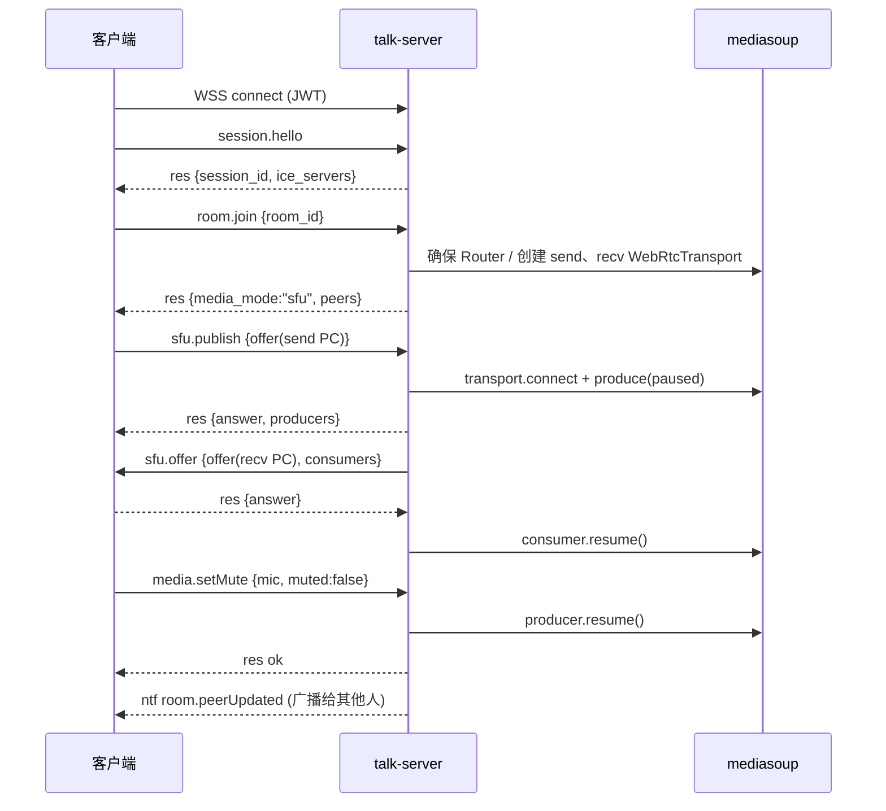
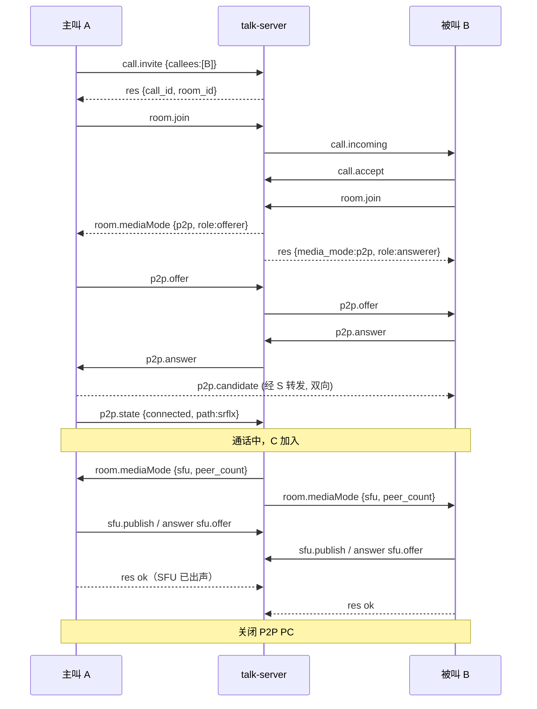

# WebRTC 对讲服务 信令协议规范 v1（草案）

> 适用范围：自研信令服务（talk-server）与各端客户端（Windows / macOS / Linux arm64(RK3568/RK3576)，后续 Web）。
> 媒体层：SFU 模式走 mediasoup，P2P 模式走客户端直连 + coturn 兜底。
> 一期仅音频；视频相关字段为**预留设计**，一期服务端可拒绝但协议结构不变。

---

## 1. 设计原则

1. **一个房间模型统一 P2P 与 SFU**：1v1 呼叫也是一个 2 人房间，区别只是 `media_mode`。业务层（成员、静音、发言权）与媒体层（P2P/SFU）解耦，模式切换不影响业务状态。
2. **客户端只说标准 SDP**：SFU 模式下由服务端把 SDP 与 mediasoup 参数互转（SDP 适配层，复用 mediasoup-client 的 `ortc`/`RemoteSdp` 逻辑在 Node 侧运行）。好处：
   - 客户端不依赖 libmediasoupclient，不被其 libwebrtc 版本锁死；
   - P2P 与 SFU 在客户端都是"PeerConnection + offer/answer"，代码路径一致；
   - 后续浏览器直接用原生 `RTCPeerConnection` 接入，协议零改动。
3. **SFU 用两条 PeerConnection**：`send`（客户端发 offer）与 `recv`（服务端发 offer），方向固定，**从根上避免 glare**。
4. **对讲形态是房间策略，不是媒体模式**：自由通话 / PTT / 主持人管控都基于同一条媒体链路，靠服务端暂停/恢复 Producer 实现。
5. **服务端是状态权威**：静音、发言权、成员、媒体模式以服务端通知为准，客户端本地操作需服务端确认。

---

## 2. 传输与消息封装

### 2.1 连接

```
wss://<host>:<port>/talk/v1/ws?token=<JWT>
```

- 生产环境必须 TLS（WSS）；开发测试环境允许 `ws://<IP>:<port>/talk/v1/ws`（原生客户端无浏览器安全上下文限制，媒体仍为 DTLS-SRTP 加密）。浏览器接入或正式上线前须切换到域名 + WSS。
- JWT 由业务后台签发，包含 `uid`、`exp`、可选 `rooms`/`roles` 权限声明。
- 一个客户端实例同一时刻只保持一条 WS 连接。
- 子协议：`Sec-WebSocket-Protocol: talk.v1.json`。

### 2.2 消息封装（JSON，UTF-8）

三种类型：`req`（请求，需应答）、`res`（应答）、`ntf`（通知，无需应答）。**双方都可以发 `req`**（如服务端向客户端发 `sfu.offer` 要求 answer）。

```jsonc
// 请求
{ "v": 1, "type": "req", "id": "c-1024", "method": "room.join", "data": { } }

// 成功应答
{ "v": 1, "type": "res", "id": "c-1024", "ok": true, "data": { } }

// 失败应答
{ "v": 1, "type": "res", "id": "c-1024", "ok": false,
  "error": { "code": 403, "reason": "forbidden", "msg": "no permission to join room" } }

// 通知
{ "v": 1, "type": "ntf", "method": "room.peerJoined", "data": { } }
```

| 字段 | 说明 |
|---|---|
| `v` | 协议主版本，不兼容变更才 +1 |
| `id` | 请求方生成，客户端前缀 `c-`，服务端前缀 `s-`，连接内唯一 |
| `method` | `<域>.<动作>`，见第 4~8 节 |
| 超时 | 请求默认 10s 未应答视为失败（`sfu.*` 可放宽到 15s） |

未知 `method` 回 `501`；未知字段**必须忽略**（向前兼容）。

### 2.3 心跳

- 客户端每 `heartbeat_interval`（默认 15s）发 `session.ping`，服务端回 `res`。
- 服务端 45s 未收到任何消息即断开；断开后保留会话 `resume_ttl`（默认 60s）用于恢复。

---

## 3. 错误码

借鉴 SIP/HTTP 语义，便于记忆：

| code | reason | 场景 |
|---|---|---|
| 400 | bad_request | 参数缺失/格式错 |
| 401 | unauthorized | token 无效/过期 |
| 403 | forbidden | 无权限（入房、踢人、发言） |
| 404 | not_found | 房间/用户/呼叫不存在 |
| 409 | conflict | 状态冲突（未入房就 publish、重复入房） |
| 429 | limited | 超过并发发言上限、频率限制 |
| 480 | unavailable | 被叫离线 |
| 486 | busy | 被叫忙 |
| 487 | cancelled | 呼叫已取消 |
| 488 | not_acceptable | 能力不匹配（无共同编解码器） |
| 500 | internal | 服务端内部错误 |
| 501 | not_implemented | 未实现的方法/功能（当前为仅含 H.265 的视频 offer） |
| 503 | overloaded | 服务过载/无可用媒体节点 |

---

## 4. 会话（session.*）

### 4.1 `session.hello`（C→S req，连接后第一条）

```jsonc
{
  "client": { "platform": "windows|macos|linux-arm64|web", "version": "1.0.0",
              "device_id": "rk3576-sn-xxxx", "sdk": "webrtc-m146" },
  "caps": {
    "audio": { "codecs": ["opus"], "aec": "webrtc|hw|none" },
    "video": { "codecs": [ { "name": "H264", "hw": true }, { "name": "H265", "hw": false } ],
               "simulcast": false, "max_recv": 9 },        // 一期单层，simulcast 预留
    "p2p": true,
    "p2p_video": true,                                     // 本端 P2P 链路能否承载视频 m-line
    "sfu_sdp": "unified-plan"
  },
  "resume": { "session_id": "sess-abc" }                   // 可选，断线恢复
}
```

应答：

```jsonc
{
  "session_id": "sess-abc",
  "uid": "u1001",
  "resumed": false,                                        // true 表示恢复了原会话（房间状态保留）
  "server_time": 1760000000000,
  "heartbeat_interval": 15,
  "resume_ttl": 60,                                        // 断线后会话保留秒数
  "room": { /* 仅 resumed=true 且仍在房间时出现，结构同 room.join 应答 */ },
  "ice_servers": [
    { "urls": ["stun:turn.example.com:3478"] },
    { "urls": ["turn:turn.example.com:3478?transport=udp",
               "turn:turn.example.com:3478?transport=tcp",
               "turns:turn.example.com:5349"],
      "username": "1760086400:u1001", "credential": "base64-hmac", "ttl": 86400 }
  ]
}
```

- `caps` 只做能力声明：服务端据此决定媒体模式与下发 `room.mediaMode`，未识别的字段忽略，**不得因此拒绝 hello**。
- `caps.video.codecs[].name` 大小写不敏感；服务端可用的 SFU 编码以 `room.join` 应答的 `sfu_video_codecs` 为准（见 5.2），客户端只在其声明的编码与实际 `MediaCapabilities` 里挑选。
- `caps.p2p_video` 缺省为 `false`：P2P 视频需要**双方都为 true** 才允许在 P2P 链路上加视频 m-line（见 7.5）。
- TURN 凭证采用 coturn `use-auth-secret`（REST 临时凭证），过期前客户端调 `session.refreshIce` 刷新。
- 连接上未完成 `session.hello` 时调用其他方法返回 `409`；同一连接重复 hello 也返回 `409`。
- 恢复条件：`resume.session_id` 仍在保留期内且属于同一 uid；否则按新会话处理（`resumed=false`，客户端需重新入房）。断线期间的通知不补发，以应答里的 `room` 快照为准。
- 同一 uid 只保留一个会话：不带 resume（或 resume 失败）的新登录会让旧会话失效，旧连接收到 `session.kicked{reason:"replaced"}` 后被以 4001 关闭，房间内其他成员收到 `room.peerLeft{reason:"replaced"}`。

### 4.2 其他

| method | 方向 | 说明 |
|---|---|---|
| `session.ping` | C→S req | 心跳 |
| `session.refreshIce` | C→S req | 刷新 `ice_servers` |
| `session.kicked` | S→C ntf | 被踢下线/异地登录，`{reason}`，随后服务端关闭连接 |
| `session.bye` | C→S req | 主动下线 |

---

## 5. 房间（room.*）

### 5.1 房间策略（policy）

```jsonc
{
  "talk_mode": "free|ptt|moderated",   // 自由通话(全双工) / 抢麦 / 主持人管控
  "max_speakers": 0,                   // 同时开麦上限，0 = 不限制（free 模式生效）
  "ptt_max_hold_sec": 60,              // PTT 单次最长占麦
  "ptt_queue": true,                   // PTT 是否排队
  "media_mode": "auto|sfu|p2p",        // auto：2 人且双方支持则 P2P，否则 SFU
  "p2p_allow_relay": true,             // P2P 是否允许走 TURN 中继
  "max_peers": 20,
  "video": { "enabled": true, "max_publishers": 9 }    // 单层 H.264；enabled=false 时房间拒绝视频轨；max_publishers 按“未关闭且未暂停”的 producer 计
}
```

### 5.2 `room.join`（C→S req）

```jsonc
{
  "room_id": "r-001",
  "display": "张三",
  "media": { "audio": { "send": true, "muted": true }, "video": { "send": false } },
  "policy": { "talk_mode": "free" }   // 可选，只在本次 join 创建房间时生效，未给出的字段取 5.1 默认值
}
```

房间由客户端即时创建：`room_id` 不存在时，服务端按 `policy` 创建房间，第一个入房者的 `role` 为 `host`；房间已存在时忽略 `policy`。最后一名成员离开（含 `resume_ttl` 超时清理）后房间销毁。

- host 离开后按入房顺序把 host 移交给下一名成员，并广播 `room.peerUpdated{uid, role:"host"}`。
- 错误：`room_id` 不合法（`[A-Za-z0-9_.-]{1,64}`）或 policy 字段无效 `400`；token 带 `rooms` 声明且不包含该房间 `403`；已在某个房间（一个会话同时只能在一个房间）`409`；人数达到 `max_peers` `429`。
- `media_mode` 决策：`talk_mode` 为 `ptt` / `moderated` 时**强制 SFU**（发言权与 producer 暂停依赖服务端控制，P2P 不生效）；仅 `free` 允许 P2P，且需两人、双方 `caps.p2p=true`、`max_peers<=2` 且未粘滞。
- `max_peers` 不超过服务端上限（`TALK_MAX_PEERS`，默认 20）。

应答：

```jsonc
{
  "room": { "room_id": "r-001", "policy": { /* 5.1 */ }, "role": "member|host" },
  "media_mode": "sfu",                       // 当前生效的媒体模式
  "sfu_video_codecs": ["h264"],              // 服务端可转发的视频编码（P2P 不受此限制）
  "peers": [
    { "uid": "u1002", "display": "李四", "platform": "linux-arm64", "role": "member",
      "audio": { "muted": false, "speaking": false },
      "video": { "camera": false, "screen": false, "on": false } }   // on = camera || screen，兼容旧客户端
  ],
  "floor": { "holder": null, "queue": [] }   // talk_mode=ptt 时有效
}
```

入房后：
- `media_mode=sfu` → 进入第 6 节流程；
- `media_mode=p2p` → 进入第 7 节流程（由服务端指定 offerer）。

### 5.3 房间方法与通知

| method | 方向 | data | 说明 |
|---|---|---|---|
| `room.leave` | C→S req | `{room_id}` | 离开房间 |
| `room.peerJoined` | S→C ntf | peer 对象 | 新成员 |
| `room.peerLeft` | S→C ntf | `{uid, reason}` | 成员离开（`leave/timeout/kicked/replaced`） |
| `room.peerUpdated` | S→C ntf | `{uid, audio?, video?, role?}` | 成员状态变化（静音、角色）；静音变化不发给本人，角色变化包括本人 |
| `room.policyChanged` | S→C ntf | policy | 策略变更（主持人切换 talk_mode 等） |
| `room.mediaMode` | S→C req | `{mode, reason, p2p_video?}` | 要求切换媒体模式，见 7.4；`p2p_video` 表示本次 P2P 链路能否承载视频（双方 `caps.p2p_video` 均 true），客户端完成后回 res |
| `room.subscribeLevels` | C→S req | `{enabled:true}` | 开启/关闭本端音量推送（开启后才有 `room.audioLevels`） |
| `room.activeSpeaker` | S→C ntf | `{uid}` | 当前主讲人（mediasoup ActiveSpeakerObserver，仅 SFU） |
| `room.audioLevels` | S→C ntf | `{levels:[{uid, level}]}` | 音量（≤2 次/秒，需 `room.subscribeLevels` 开启，仅 SFU） |
| `media.producer` | S→C ntf | `{uid, mid, kind, source, paused}` | 成员 producer 的暂停/恢复/关闭，见 6.6 |
| `room.closed` | S→C ntf | `{reason}` | 房间解散 |

### 5.4 静音（media.*）

| method | 方向 | data | 说明 |
|---|---|---|---|
| `media.setMute` | C→S req | `{source:"mic|camera|screen", muted}` | 开/关麦、摄像头、屏幕共享。开麦可能返回 `429`（超过 `max_speakers`）或 `403`（moderated 无发言权） |
| `media.forceMute` | S→C ntf | `{source, by}` | 被主持人/策略强制静音 |

`source` 的语义（三者互相独立，共享开关**不再隐含在 `camera` 里**）：

| source | 作用对象 | 应答 |
|---|---|---|
| `mic` | `kind=audio` 的 producer | `{audio:{muted,speaking}}` |
| `camera` | `kind=video` 且 `source=camera` 的 producer | `{video:{camera,screen,on}}` |
| `screen` | `kind=video` 且 `source=screen` 的 producer | `{video:{camera,screen,on}}` |

实现约定：
- 客户端关麦：本地 `RtpSender` 置 `active=false`（不再发包），服务端 `producer.pause()`。
- 客户端开麦：先发 `media.setMute{muted:false}`，**收到成功应答后**再恢复发送，保证服务端策略生效。
- **屏幕共享停止时客户端必须发 `media.setMute{source:"screen", muted:true}`**（不发 `video.stop` 之类的本地命令），服务端据此 `producer.pause()`、广播 `media.producer`，并释放 `video.max_publishers` 名额；下一次开共享沿用同一 mid 重新 `sfu.publish` 时不会因“同 uid 同 source 去重”被 `409`。
- P2P 模式下 `media.setMute` 仍发给服务端（用于状态同步），媒体侧本地处理。

---

## 6. SFU 媒体（sfu.*）

### 6.1 连接模型

```
客户端                                   talk-server                    mediasoup
 send PC  ── offer(sendonly m-lines) ──►  SDP 适配 → transport.produce() ─► Producer
 recv PC  ◄─ offer(recvonly m-lines) ──   transport.consume()          ◄── Consumer
```

- 两个 PC 各对应 mediasoup 一个 `WebRtcTransport`，挂在 `WebRtcServer`（单 UDP/TCP 端口复用，便于防火墙）。
- mediasoup 为 ICE-Lite：服务端候选随 answer/offer 下发，**SFU 模式不需要 trickle candidate**。
- 传输开启 `transport-cc`（TWCC），音频 Opus 参数见 9.1。

### 6.2 发布：`sfu.publish`（C→S req）

```jsonc
{
  "sdp": "v=0...",                      // send PC 的 offer
  "tracks": [ { "mid": "0", "kind": "audio", "source": "mic" } ]
}
```

应答：

```jsonc
{
  "sdp": "v=0...",                      // answer
  "producers": [ { "mid": "0", "producer_id": "p-xx", "kind": "audio", "source": "mic",
                   "codec": "opus", "paused": true } ]
}
```

- 新增/删除发送轨（后续加摄像头）时重新 `sfu.publish`，携带完整 offer；删除的轨在 `tracks` 中标记 `"closed": true`。
- 同一 mid 的视频轨重发布（如屏幕共享停后再开）若 `codec` 与保留下来的 producer 一致，则复用原 producer 只改 `paused`，不重建；编码/参数变化才走 close+produce（见 6.6）。
- 视频轨受房间策略约束，违反返回 `409`：`video.enabled=false`；房间内 **未关闭且未暂停** 的视频 producer 数已达 `video.max_publishers`（本端同 mid 重发布不重复计入）；同一 `uid` 存在另一个**未暂停**的同 `source` 视频 producer（自己把自己旧路的 `paused` 置 true 再发不算冲突）。

### 6.3 订阅：`sfu.offer`（S→C req）

服务端在需要增删 Consumer 时向客户端发起：

```jsonc
{
  "sdp": "v=0...",                      // recv PC 的 offer
  "consumers": [
    { "mid": "3", "consumer_id": "c-yy", "producer_id": "p-xx", "uid": "u1002",
      "kind": "audio", "source": "mic" }
  ],
  "closed": ["1"]                        // 本次关闭（置 inactive、可复用）的 mid
}
```

客户端回 res：`{ "sdp": "<answer>" }`。

约定：
- 服务端对每个客户端的 recv 协商**串行排队**，上一轮 answer 回来才发下一轮；短时间内的多个变化（如多人同时入房）**合并成一次 offer**（合并窗口 100ms）。
- Consumer 以 `paused` 创建，收到 answer 后服务端 `consumer.resume()`（mediasoup 推荐做法，避免首包丢失）。
- `inactive` 的 m-line 会被复用，SDP 不随成员进出无限增长。

### 6.4 订阅策略（全量订阅）

单房间 ≤ 20 人，**每个成员入房后即为其他所有成员的音频 Producer 建 Consumer**，三种 talk_mode 相同：

- 关麦/无发言权只是 `producer.pause()`，Consumer 保留，**开关麦与抢麦都不触发重协商**；
- recv 重协商只发生在成员进出房间时；
- 每端最多 19 路音频 m-line，SDP 体积可控；
- libwebrtc 接收端默认只混音最响的 3 路，多人同时说话时听感不会糊成一片。

估算（Opus 32kbps 含包头约 40kbps，DTX 静音时几乎不占带宽）：

| 场景 | 每端下行 | 房间服务端出流量 |
|---|---|---|
| 典型（同时 2~3 人说话） | ≈ 120kbps | ≈ 2.4Mbps |
| 极端（20 人同时开麦说话） | ≈ 760kbps | ≈ 15Mbps |

单房间 Consumer 数 = 20 × 19 = 380，单个 mediasoup worker 即可承载。

### 6.5 其他

| method | 方向 | data | 说明 |
|---|---|---|---|
| `sfu.restartIce` | C→S req | `{pc:"send|recv"}` | send：客户端带 `iceRestart` 的新 offer 走 `sfu.publish`；recv：服务端随后发 `sfu.offer` |
| `sfu.stats` | C→S ntf | `{pc, rtt, jitter, loss, bitrate}` | 每 10s 上报质量（用于监控） |
| `sfu.consumerLayers` | C→S req | `{consumer_id, spatial, temporal}` | 预留：视频选层 |
| `sfu.keyframe` | C→S req | `{consumer_id}` | 预留：请求关键帧 |

### 6.6 producer 状态广播

`media.producer`（S→C ntf）在以下时机广播给房间内**除本人外**的成员：

| 时机 | 字段 |
|---|---|
| `sfu.publish` 新建/重建 producer | `{uid, mid, kind, source, paused}`（可带 `producer_id`） |
| `media.setMute` 使 `producer.pause()/resume()` | 同上，`paused` 为目标值 |

- 成员离开不看这个通知，以 `room.peerLeft` 为准；producer 因重发布被重建时以 `sfu.offer` 的 `consumers` 为准。

- 用作接收端的“最后一帧/断流”提示：`screen` 变 `paused=true` 时对端可以立刻清空共享画面，不必等 RTP 超时。
- 与 `room.peerUpdated` 的分工：`peerUpdated.video` 是用户意图（自报状态），`media.producer` 是媒体事实（服务端 `pause/resume` 后的结果）；以 `media.producer` 为准。

---

## 7. 呼叫与 P2P（call.* / p2p.*）

### 7.1 呼叫（1v1，及"拉人"）

| method | 方向 | data | 说明 |
|---|---|---|---|
| `call.invite` | C→S req | `{callees:[uid], media:{audio, video}, room_id?}` | 发起呼叫；不带 `room_id` 则服务端新建房间；res 返回 `{call_id, room_id}` |
| `call.incoming` | S→C ntf | `{call_id, room_id, from, media}` | 来电 |
| `call.ringing` | C→S req / S→C ntf | `{call_id}` | 被叫振铃回执 |
| `call.accept` | C→S req | `{call_id}` | 接听；之后被叫执行 `room.join` |
| `call.reject` | C→S req | `{call_id, code}` | 拒接，`486/603` |
| `call.cancel` | C→S req | `{call_id}` | 主叫取消 |
| `call.state` | S→C ntf | `{call_id, state, code?}` | `ringing/accepted/rejected/cancelled/timeout/ended` |
| `call.hangup` | C→S req | `{call_id}` | 挂断（1v1 时房间随之关闭） |

- 主叫在 `call.invite` 成功后立即 `room.join`（先入房等待），被叫接听后入房。
- 振铃超时默认 45s，服务端发 `call.state{timeout}`。

### 7.2 P2P 协商（服务端只转发）

入房应答或 `room.mediaMode` 中，服务端下发：

```jsonc
{ "media_mode": "p2p", "p2p": { "peer": "u1002", "role": "offerer|answerer", "session": "p2p-1" } }
```

- **offerer 由服务端指定**（默认主叫），避免 glare。
- 消息都带 `session`，丢弃旧 session 的迟到消息。

| method | 方向 | data |
|---|---|---|
| `p2p.offer` | C→S→C ntf | `{session, to/from, sdp}` |
| `p2p.answer` | C→S→C ntf | `{session, to/from, sdp}` |
| `p2p.candidate` | C→S→C ntf | `{session, to/from, candidate, sdp_mid, sdp_mline_index}`；`candidate` 为空表示结束 |
| `p2p.state` | C→S ntf | `{session, state:"connecting|connected|failed|closed", path:"host|srflx|relay"}` |

### 7.3 P2P 失败回退

```
offerer/answerer 开始 ICE
   ├─ 10s 内任一方上报 connected        → 保持 P2P
   ├─ 任一方上报 failed / 10s 超时       → 服务端下发 room.mediaMode{mode:"sfu", reason:"p2p_failed"}
   └─ p2p_allow_relay=false 且 path=relay → 同上，转 SFU
```

### 7.4 模式切换（make-before-break）

触发：P2P 房间有第 3 人加入（`reason:"peer_count"`）、P2P 失败、主持人修改策略。

```
S → A,B : room.mediaMode(req) {mode:"sfu"}
A,B     : 建 send/recv PC → sfu.publish → 等 sfu.offer 并 answer
A,B     : 收到对端音频首包（或 consumer resume 后 2s）
A,B → S : res(room.mediaMode) {ok}
S       : 两端都 ok 后通知 p2p 关闭 → A,B 关闭 P2P PC
```

- 切换期间两条链路同时存在，客户端**仅播放一路**：新链路出声后再静音旧链路，用户无感。
- SFU → P2P 的回切默认关闭（避免人数在 2/3 间抖动导致来回切换），可配置为"稳定 2 人 30s 后回切"。

### 7.5 P2P 视频与 H.265

- P2P 模式下媒体两端直连，服务端只转发 SDP/ICE，**不解析 m-line**，因此编码不受服务端 `sfu_video_codecs` 限制。
- 允许在 P2P 链路上开视频的条件：双方 `caps.p2p_video=true`；否则 `room.mediaMode.p2p_video=false`，客户端不得发起视频轨（要视频必须 `media_mode=sfu`）。
- P2P 视频沿用客户端预发布的三条 m-line（audio/camera/screen，mid 0/1/2）：应答方必须先 `SetRemote` 再 `AddTrack`；启停共享只切本地 sender 的 `active` + 停采，并额外发 `media.setMute{source:"screen"}` 同步状态。
- **H.265 仅 P2P 可用**：需 SDK 以 `rtc_use_h265=true` 编译 + 外部编解码器注入。服务端 SFU 暂不支持 H.265（mediasoup 3.16.6 已移除该编码），含 H.265 的 `sfu.publish` 仍返回 `501`，见 9.2。

---

## 8. 发言权（floor.*，talk_mode=ptt/moderated）

- **仅 SFU 模式生效**：`talk_mode` 为 `ptt`/`moderated` 时房间强制 `media_mode=sfu`（见 5.2）；P2P 房间里主持人切到 PTT 会触发 `room.mediaMode{mode:"sfu",reason:"policy"}`。
- **单麦口**：同一时刻只有一个 holder，其余按申请先后 FIFO 排队；`ptt_max_hold_sec` 到期自动收回（`reason:"timeout"`）并让队首递补。
- `max_speakers` **只在 `free` 模式生效**（口径见 5.1：按“未关闭且未暂停”的 audio producer 计），超限时 `media.setMute{muted:false}` 返回 `429`；`ptt`/`moderated` 靠单 holder 限流，不再叠加人数上限。

| method | 方向 | data | 说明 |
|---|---|---|---|
| `floor.request` | C→S req | `{}` | 申请发言。res：`{granted:true}` 或 `{granted:false, queue_pos}` 或错误 |
| `floor.release` | C→S req | `{}` | 释放发言 |
| `floor.state` | S→C ntf | `{holder, queue:[uid], expires_at}` | 发言权状态广播 |
| `floor.revoked` | S→C ntf | `{reason:"timeout|preempt|host"}` | 被收回 |
| `host.grant` | C→S req | `{uid, allow}` | 主持人授予/收回发言权（moderated） |
| `host.muteAll` | C→S req | `{except:[uid]}` | 全员静音 |
| `host.kick` | C→S req | `{uid}` | 踢出房间 |
| `host.setPolicy` | C→S req | policy 局部字段 | 修改房间策略 |

PTT 的媒体实现：
- 入房即 publish，producer 默认 `paused`；
- `floor.request` 获批后服务端 `producer.resume()` 并广播 `floor.state`，客户端收到应答后恢复发送；
- 其他成员的 Consumer 已预先建立（6.4），抢麦不需要重协商；
- 目标：按键到对端出声 < 300ms。

### 8.1 实现口径（服务端 `server/src/room/floor.ts`）

`floor.request`：

| 当前状态 | `talk_mode` | 应答 | 服务端动作 |
|---|---|---|---|
| 任意 | `free` | `{granted:true}` | 不占 floor，也不需要 `floor.release` |
| 本人已是 holder | `ptt`/`moderated` | `{granted:true}` | 幂等，不重置超时 |
| 非主持人 | `moderated` | `{granted:false, queue_pos}` | 一律入队，等 `host.grant{allow:true}`；避免“谁先按谁先说” |
| 空闲 | `ptt`/`moderated` | `{granted:true}` | `setMuted(false)` + `producer.resume()` + 广播 `floor.state` |
| 被占用且 `ptt_queue=true` | `ptt` | `{granted:false, queue_pos}` | 入队（重复申请返回原位置，不重复排队） |
| 被占用且 `ptt_queue=false` | `ptt` | `{granted:false}` | 不入队，客户端下次按键再试 |

- `moderated` 下主持人自己按麦直接获批（不需要自授权），但同样占用单麦口，主持人改授他人时原持有人收到 `floor.revoked{reason:"preempt"}`。
- `floor.release`：holder 释放 → 暂停 producer、清定时器、队首递补；仅是排队者释放 → 只移出队列。
- `host.grant{uid, allow:false}`：若 `uid` 是 holder → `floor.revoked{reason:"host"}` + 暂停 + 递补；若仅在排队 → 移出队列。
- `host.muteAll{except}`：对每个成员 `setMuted(true)` + 给本人 `media.forceMute{source:"mic"}` + 广播 `media.producer`，最后清空 floor 并广播 `floor.state{holder:null}`；res 返回 `{muted:[uid]}`。
- `host.kick{uid}`：先 `floor.drop` 收尾，再 `room.peerLeft{reason:"kicked"}` 广播、给本人 `session.kicked{reason:"kicked"}`、以关闭码 `4003` 断开；不能踢自己（`400`）。
- 成员离开（`leave/timeout/kicked/replaced`）与房间关闭会自动清理队列与定时器；`talk_mode` 变化时（`policyChanged`）清空 floor，切进 `ptt`/`moderated` 还会把全员静音（`media.producer` 广播 `paused:true`）。
- 错误：`floor.request` 在 `media_mode=p2p` 下 `409`（发言权依赖服务端暂停 producer）；`host.grant` 在 `free` 模式 `409`（没有发言权概念）；`host.*` 非主持人 `403`，非本房间成员 `404`。

### 8.2 音量与主讲人（仅 SFU）

- `room.subscribeLevels{enabled}` 是按会话开关：应答 `{enabled, media_mode}`，关闭后不再收到 `room.audioLevels`；重连/重发 `session.hello` 后需要重新开启。
- `room.activeSpeaker{uid}`：`ActiveSpeakerObserver`（`interval=300ms`）的 `dominantspeaker` 事件，广播给房间内所有人，不做订阅过滤。
- `room.audioLevels{levels:[{uid, level}]}`：`AudioLevelObserver`（`maxEntries=24, threshold=-70dBov, interval=500ms`，即 ≤2 次/秒），只推给已订阅的成员；`level` 由 dBFS 映射到 `0..1` 并保留两位小数（`(dB+100)/100` 截断），`0` 表示静音。
- 上台 `producer.resume()` 的瞬间 observer 才开始产出电平，`paused` 的 producer 不会出现在 `levels` 里，客户端可据此把未上台者置灰。

---

## 9. 媒体参数约定

### 9.1 音频（一期）

| 项 | 值 |
|---|---|
| 编码 | Opus 48kHz，单声道 |
| ptime | 20ms |
| 码率 | `maxaveragebitrate=32000`（弱网自适应 16~32k） |
| FEC / DTX | `useinbandfec=1; usedtx=1` |
| 3A | libwebrtc APM：AEC3 + NS + AGC2；带硬件回采的板卡可配置 `aec:"hw"` |
| RTP 扩展 | `ssrc-audio-level`、`transport-wide-cc`、`abs-send-time` |

### 9.2 视频

当前服务端（SFU）已实现单层 H.264。Simulcast、VP8 和选层仍按下面的后续约定，尚未实现；H.265 只在 P2P 链路上可用。

| 项 | 约定 |
|---|---|
| 当前（SFU） | 单层 H.264 Constrained Baseline `42e01f`，`packetization-mode=1`。`sfu.publish` 可带视频轨；`media.setMute{source:camera|screen}` 暂停/恢复对应的视频 producer。仅含 H.265/HEVC 的 `sfu.publish` 返回 `501` |
| 当前（P2P） | H.264 / H.265 由两端协商，服务端不参与；H.265 需双方 SDK 以 `rtc_use_h265=true` 编译且 `caps.video.codecs` 声明 |
| 编码优先级（后续） | SFU：H.264 > VP8（H.265 待 mediasoup 上游 issue #1789 或自维护 worker 补丁，见 6.2） |
| 发布（后续） | Simulcast 3 层（如 720p/360p/180p，rid `h/m/l`）；RK 端 MPP 硬编不支持多路时保持单层 |
| 订阅（后续） | 每端最多 `video.max_recv` 路；按渲染尺寸通过 `sfu.consumerLayers` 选层 |
| 控制 | NACK、PLI/FIR、TWCC 带宽估计；屏幕共享 `source:"screen"` |
| 协议影响 | 只新增 `tracks[].source/kind=video` 与 `sfu.consumerLayers/keyframe`，**不改已有消息** |

---

## 10. 断线与恢复

| 场景 | 处理 |
|---|---|
| WS 断开、媒体正常 | 客户端指数退避重连（1/2/4/8s，上限 15s），`session.hello` 带 `resume.session_id`；`resumed=true` 时房间状态保留，不重新入房 |
| WS 恢复超时（>60s） | 服务端清理成员、广播 `room.peerLeft{timeout}`；客户端需重新 `room.join` |
| ICE 断开（网络切换） | SFU：`sfu.restartIce`；P2P：offerer 发 `iceRestart` offer；失败则走 7.3 回退 |
| 服务端媒体节点故障 | 服务端下发 `room.mediaMode{mode:"sfu", reason:"migrate"}`，客户端在新节点重建 send/recv PC |

---

## 11. 关键时序

### 11.1 入房 + SFU 音频



### 11.2 1v1 呼叫 P2P，第三人加入转 SFU



---

## 12. 安全

- 全链路 WSS；媒体 DTLS-SRTP（WebRTC 强制）。测试期例外：信令走 `ws://IP`，token 用服务端 `/dev/token` 签发的开发 token。
- JWT 校验 `exp`、房间权限；`host.*` 校验角色。
- TURN 仅发临时凭证（HMAC，默认 24h），coturn 配置 `denied-peer-ip` 禁止中继到内网。
- 服务端限流：每连接请求 ≤ 50/s，`p2p.candidate` ≤ 100/会话。
- 端到端加密（E2EE）预留：基于 libwebrtc FrameTransformer，二期以后评估。

---

## 13. 版本演进规则

- 新增 method / 字段：不升 `v`，接收方忽略未知内容。
- 已发生的字段扩展（均不升 `v`）：`peerUpdated.video` 从 `{on}` 扩为 `{camera,screen,on}`；`media.setMute.source` 增加 `screen`；`room.mediaMode` 增加 `p2p_video`；新增 `media.producer` 与 `room.subscribeLevels`。
- 字段语义变化或删除：升 `v`，服务端同时支持 `v` 与 `v-1` 至少一个大版本周期。
- 客户端在 `session.hello` 上报 `version`，服务端可对过旧版本返回 `426`（升级提示，扩展码）。
